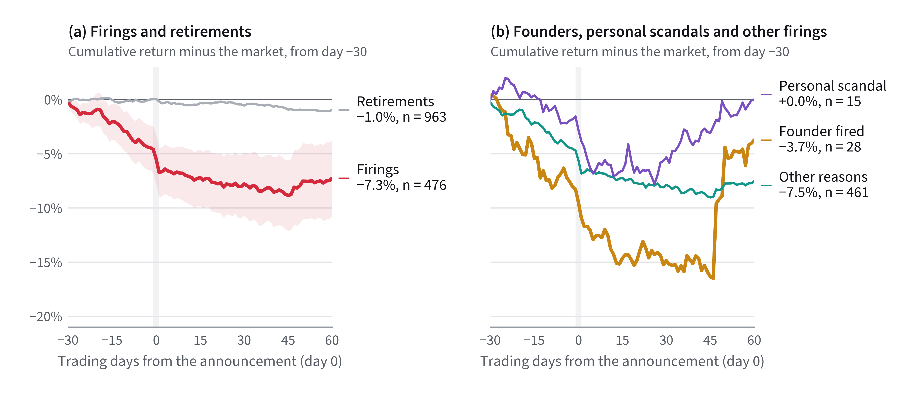
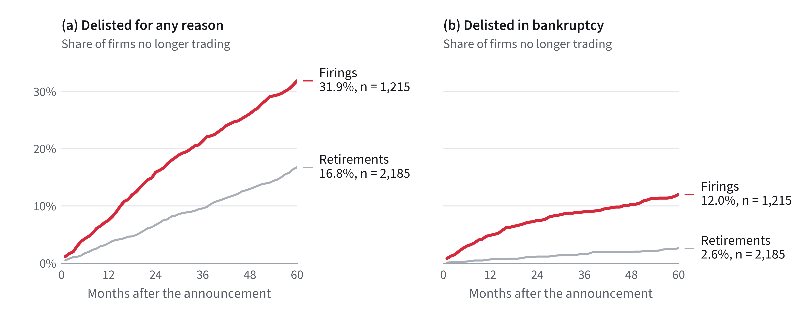

# Sacked: Sex, Fraud, Founders, and the Fate of Firms That Fire Their CEO

Replication package for Abhishek Sehgal, *Sacked: Sex, Fraud, Founders, and the Fate of Firms That Fire Their CEO*
(working paper, November 2026). Every number, table and figure in the paper is produced by the code here.

**Read the paper:** [paper/Sacked.pdf](paper/Sacked.pdf) (two columns, 17 pages). The text with every statistic
filled in is [paper/paper.md](paper/paper.md).

**The question.** What happens to a US public company after its board fires the chief executive, and does it matter
whether the chief executive founded the company, or was fired over a sex scandal rather than fraud? We follow every
firing at an S&P 1500 firm from 1998 to 2023 (1,272 firings with prices, 83 of them of founders; 2,253 retirements as
the comparison) from six weeks before the announcement to five years after it, with the number of firms measured at
every horizon. The 121 firings over fraud, another legal violation or a criminal charge are kept apart as a
comparison group. Announcement windows use the 486 firings dated by the database or by hand; long-run results use
every firing.



## What we find

| Horizon | Firings | Retirements | N firings |
|---|---|---|---|
| Trading days −30 to −2, return minus the market | −5.2% | 0.0% | 486 |
| Trading days −1 to +1, abnormal return | −2.4% | −0.3% | 483 |
| Trading days +2 to +60, return minus the market | −0.5% (n.s.) | −0.8% | 476 |
| 12 / 36 / 60 months, median return minus a matched firm | −4.8% / −0.5% (n.s.) / −4.7% (n.s.) | 0.0% / 0.5% / 2.8% | 1,220 / 1,217 / 1,164 |
| 36 months, five-factor and momentum alpha, a month | 0.04% (n.s.) | 0.13% | 319 months |
| Within 60 months, share delisted | 31.9% | 16.8% | 1,215 |

* **The market sees it coming.** The shares slide for six weeks, fall a further 2.4% over the three days around the
  announcement, then stop.
* **Founders and sex scandals change little; fraud does.** Fired founders' shares fall 5.0% against 2.2% for hired
  chief executives, a gap that is not significant (p = 0.32) and is +0.6 points with size and prior-return controls.
  After a sex or other personal scandal the fall is 1.1% (40 firings, every date source), about the same as other
  firings; after fraud or another legal violation it is 4.8% (121 firings; difference 3.6 points, p = 0.021).
* **The lasting difference is survival.** Within five years 31.9% of firing firms are delisted, against 16.8% after a
  retirement, in every size band. With controls for size, profitability, prior return, leverage, book-to-market,
  distress and losses, the gap is 6.5 percentage points (p = 0.006). Risk-adjusted returns are close to zero.



## Replicate it

Three levels, from no data at all to the full pipeline.

| Level | What it rebuilds | What you need | Command |
|---|---|---|---|
| **1** | Every statistic, table and figure in the paper | Python and this repository | `python check.py` |
| **2** | The event-level files (returns, delistings, matched firms) from raw prices and statements, then Level 1 | Licensed prices and fundamentals: Sharadar, or CRSP and Compustat (WRDS), or an equivalent; see [DATA.md](DATA.md) | `make inputs-sharadar SHARADAR_DIR=...` or `make inputs-crsp WRDS_DIR=...`, then `python run_level2.py` |
| **3** | The founder, reason and board codes from filings and news | An OpenAI-compatible LLM key, `SEC_USER_AGENT`, free news API keys | `code/evidence_fetch.py`, `code/code_events.py`, `code/extract_board.py` |

```bash
git clone https://github.com/vastdreams/founder-ceo-replication && cd founder-ceo-replication
python -m venv .venv && . .venv/bin/activate && pip install -r requirements.txt
python check.py      # 386 statistics and 16 tables checked, 0 differ; figures in outputs/figures/
```

**Bring your own data (Level 2).** The code never reads a vendor table. `code/datasource.py` serves nine canonical
tables from `data/inputs/`, and an adapter in `code/adapters/` writes them from your vendor's export:
`sharadar.py` (Nasdaq Data Link bulk CSVs), `crsp_compustat.py` (WRDS exports; the better source, with actual
delisting returns), `french.py` and `gentry.py` (free downloads), `edgar.py` (SEC filing index). The free tables
ship in `data/inputs/` already. [DATA.md](DATA.md) defines every table and column and names an equivalent source
for each. Buy your own licence for prices and fundamentals: they are not redistributed here, and free price sources
miss the delisted firms that make up a third of the sample after five years.

We verified the plug-in path end to end: exporting our Sharadar tables as vendor CSVs, running the adapter and
rebuilding the event-level files reproduces ours exactly. With CRSP and Compustat expect small differences (price
adjustments, delisting dates, matched firms) and the same conclusions; `run_level2.py` reports them.

## What is here

```
check.py            Level 1: rebuild and compare every statistic and table, redraw the figures
run_level2.py       Level 2: rebuild the event-level files from your data, then compare
DATA.md             data dictionary: every input, every column, sources, licences, equivalents
code/               the analysis (the same code that produced the paper) and the adapters
data/inputs/        free canonical inputs: CEO dismissal database, gvkey-CIK links, Wikidata founders, SEC index
data/events/        event-level results: returns, delistings, matched firms, codes, board outcomes
data/reviews/       hand reviews of every founder, fraud, conduct and scandal code, date corrections and exclusions
results/            the published statistics (combined_results.json), figure series and the inputs that need licensed data to rebuild
figures/            the paper's figures
paper/              the paper (PDF and filled text), its template and the method decisions (DECISIONS.md)
```

Every statistic carries its horizon (how long after the announcement it is measured) and its N, and the build
stops if one does not (`code/combine_results.py`).

## Licences and citation

Code: MIT ([LICENSE](LICENSE)). Our data (event-level results, codes, hand reviews, link tables): CC BY 4.0
([LICENSE-DATA](LICENSE-DATA)). The CEO dismissal database is CC BY 4.0: cite Gentry, Harrison, Quigley and Boivie
(2021, *Strategic Management Journal*) and Zenodo record 17725939. SEC data are public domain. Wikidata is CC0.

Cite this package with [CITATION.cff](CITATION.cff).
