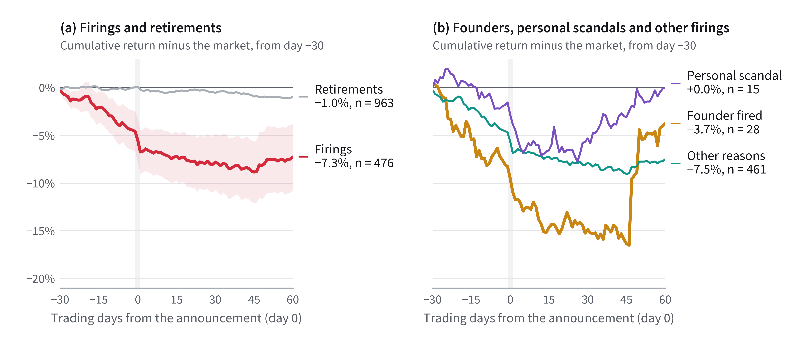
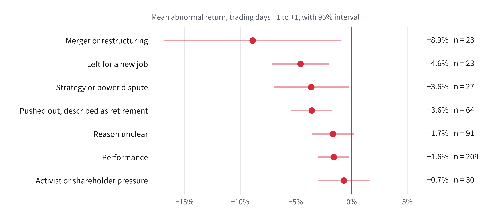
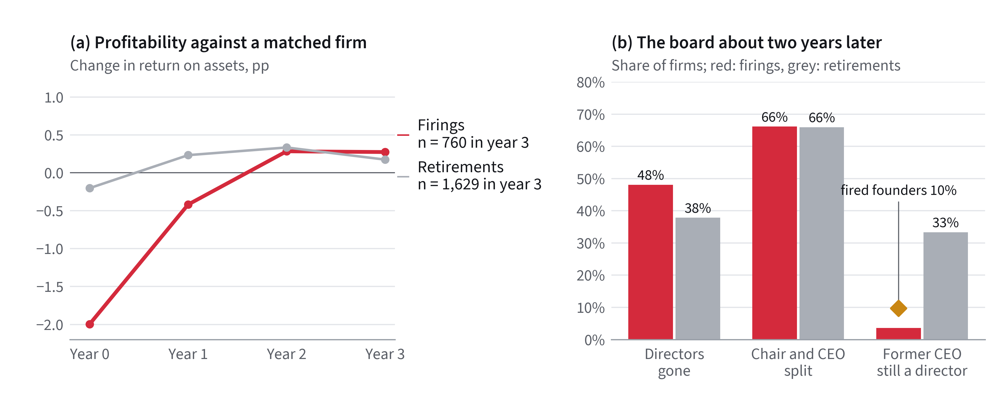

# Sacked: Sex, Fraud, Founders, and the Fate of Firms That Fire Their CEO

## Abstract

This paper answers what happens when a board fires its chief executive. At Standard & Poor's 1500 firms the shares, already lagging the market, fall 2.4% over the three trading days around the announcement of a firing. After a sex or other personal scandal the fall is similar, and 3.6 percentage points smaller than after fraud or another legal violation. After a founder's firing it is 2.8 percentage points larger, which is not significant (p = 0.322). Risk-adjusted returns over three years are near zero, yet 31.9% of the firms are delisted within five years, against 16.8% after retirements.

::: keynumbers

- **[−2.4%]{.focal}** share price over trading days −1 to +1 around the announcement of a firing (n = 483)

- **31.9%** of firing firms delisted within five years (n = 1,215), against 16.8% after a retirement; 6.5 percentage points more with controls (p = 0.006)

:::

## 1. Introduction

::: findings

1. In the six weeks before a firing is announced, the shares lag the market by 5.2% (Table 1).

2. Over the three trading days around the announcement they fall a further 2.4%, and the next three months add no significant move (Table 1).

3. Over those three days the shares fall 5.0% when a founder is fired and 2.2% when a hired chief executive is, a gap that is not statistically significant (Table 2).

4. After a firing over a personal scandal the shares fall 1.1% over those three days, against 4.8% after a firing over fraud or another legal violation (Table 2).

5. Within five years firing firms are delisted more often than retirement firms of every size (Table 3). With controls for size, leverage and distress the gap is 6.5 percentage points (Table 4).

:::

In 1985 Apple's board sided with its new chief executive against Steve Jobs, and Jobs left the company he had founded. By 1997 Apple had bought his next company and he was back in charge. In November 2026 Nvidia's board accepted the resignation of its co-founder and chief executive, Jensen Huang [@nvidia2026form8k]. Three days earlier it had opened an independent investigation after reports that Huang had been the target of a foreign intelligence effort [@nvidia2026board]. News reports also described an affair [@cnbc2026nvidia]. The board gave no reason.

Nvidia's shares closed 4.3% lower that day, after falling as much as 14% during the session [@cnbc2026nvidia]. By 18 November they had lost 19.1% from the last close before the board's statement. Every investor, director and employee asks the same thing when a board turns on its chief executive: what happens to the company now? And does it matter that the person fired built it, or that the trouble was a scandal rather than the business?

This paper answers both questions for the chief executives that Standard & Poor's (S&P) 1500 boards fired from 1998 to 2023. There are 1,272 such firings with share prices, 83 of them of founders. Firings over fraud or another legal violation are a different event, because the firm itself is in trouble with the law, so those 121 are kept apart as a comparison.

The short answer is that the market has usually seen it coming. Boards tend to fire chief executives after poor results [@jenter2015], and in the six weeks before the announcement the shares lag the market by 5.2%. At the announcement they fall a further 2.4% over three trading days, and then they stop: the next three months add no significant move (Table 1). Against a similar firm they trail by a further 4.8% over the first year (p = 0.028), and not significantly after that.

Founders and sex scandals make the headlines, but they change the reaction little. When the chief executive founded the firm, the fall at the announcement is larger, 5.0% against 2.2%, but not significantly so (p = 0.322; Table 2). Hold firm size and the prior year's return constant, and the founder gap is 0.6 percentage points in the other direction (p = 0.689). A sex or other personal scandal is followed by about the same fall as any other firing. Fraud is the exception: after a firing over fraud or another legal violation the fall is 3.6 percentage points larger than after a personal scandal (Table 2).

What does change is survival. Within five years 31.9% of firing firms are delisted, against 16.8% after a retirement, and the gap holds in every size band (Table 3 and Table 4). Yet once risk is priced the shares earn about what they should. A portfolio of firing firms, held for three years after each announcement, earns 0.04% a month after the five Fama-French factors and momentum. That portfolio includes the firms that failed. One reading is that a firing marks a firm whose risk has risen, and that the price already reflects it.

Table 1 sets out each result with its horizon and the number of firings behind it.

::: glance

### Table 1. The firing, horizon by horizon: S&P 1500 firms, 1998 to 2023

| Horizon | What is measured | Firings | Retirements | N firings | p |
|---|---|---|---|---|---|
| Trading days -30 to -2 | Return minus the market | -5.2% | 0.0% | 486 | <0.001 |
| Trading days -1 to +1 | Abnormal return, market model | -2.4% | -0.3% | 483 | <0.001 |
| Trading days +2 to +60 | Return minus the market | -0.5% | -0.8% | 476 | 0.708 |
| 12 months | Return minus a matched firm, median | -4.8% | 0.0% | 1,220 | 0.028 |
| 36 months | Return minus a matched firm, median | -0.5% | 0.5% | 1,217 | 0.704 |
| 36 months | Five-factor and momentum alpha, a month | 0.04% | 0.13% | 319 | 0.855 |
| 60 months | Return minus a matched firm, median | -4.7% | 2.8% | 1,164 | 0.237 |
| Within 60 months | Share of firms delisted | 31.9% | 16.8% | 1,215 | <0.001 |
| Fiscal year +1 | Change in ROA minus the matched firm, median (pp) | -0.4 | 0.2 | 971 | 0.057 |
| About two years | Share of pre-firing directors not in the later proxy | 48.0% | 37.8% | 566 | <0.001 |

*Notes.* Firings exclude firings over fraud or another legal violation. Day 0 is the first trading day on or after the announcement. The first three rows use hand-dated firings, the rest every firing. A month is 21 trading days from day +2. For the alpha row, N counts calendar months and the portfolio holds firms for 36 months after the announcement. N falls with the horizon as recent firings have not reached it. p tests the firing number against zero, or, for the delisted and directors rows, against retirements.

:::

## 2. Related work

Boards fire chief executives after poor performance, including poor performance of the whole industry [@jenter2015], and returns fall well before the change [@weisbach1988]. Forced exits are rare, which suggests that boards behave as if replacing a chief executive were costly [@taylor2010; @kaplan2012]. How the market reacts depends on what the firing reveals about the firm [@kind2011; @chen2026]. A firing should therefore lower the share price at the announcement, but by less than the decline that preceded it.

Founder-led firms invest differently and have been valued more highly [@fahlenbrach2009]. Founder status itself responds to performance [@adams2009], founders are often replaced as their firms mature [@wasserman2003; @aran2024], and in venture-backed startups replacing the founder improves outcomes [@ewens2018]. If founders carry value a successor cannot replace, their firing should cost more. If boards act against founders only when the case is overwhelming, the firing could end entrenchment and be good news [@taylor2010].

Executive scandals and financial misreporting both cost shareholders [@cline2018; @larcker2016; @borellikjaer2021; @karpoff2008jfqa], and managers who misreport usually lose their jobs [@karpoff2008jfe]. Studies of misconduct usually combine the two. A fraud tells investors that numbers they relied on were wrong, while a personal scandal concerns one person, so a firing over a personal scandal should cost less.

Against this work, the paper separates firings over a personal scandal from firings over fraud, which studies of misconduct usually combine. It follows each firing from six weeks before the announcement to five years after, with the number of firms measured at every horizon. And it checks by hand who was a founder and why the board acted, wherever an error would change a result.

## 3. Data and design

### Which firings

The departures come from the open CEO dismissal database of @gentry2021, extended by its authors to 2023. It codes the reason for every chief executive departure at S&P 1500 firms from press coverage and filings, and an independent recoding agreed with it on 87% of events [@gentry2021]. Codes 3 and 4, dismissal for job performance and for legal violations or personal conduct, are firings. Code 5, voluntary retirement, is the comparison group.

Press releases rarely say that a chief executive was fired [@gow2017], and how forced exits are classified changes the results [@fee2018]. Like the database, we treat a resignation under board pressure as a firing, including one during an investigation, a scandal or an activist campaign.

From the firings we remove the 121 whose main reason is fraud or another legal violation. These are financial misconduct, a legal or regulatory breach by the firm, or a criminal charge against the chief executive. A personal scandal is a firing over sexual misconduct, a relationship with an employee, conduct at work or another personal failing such as a false degree. There are 40 of them, of which 3 are founders, too few for a test.

Each departure is linked to the firm's Central Index Key, its identifier at the Securities and Exchange Commission, and through it to daily prices that include firms later delisted. Table IA.1 traces the firings from the database to the samples, and Figure IA.1 shows them by year.

### Dating the announcement

A three-day window needs the right day. The database gives an announcement date for about a third of departures, and otherwise only the day the chief executive left office, which can come weeks after the news. The firm's own 8-K filing on the departure gives a second date, but on departures the database does date, the two agree within 3 days in only 58% of cases.

That is too noisy for a three-day window. Firings dated by the database earn -2.4% over three days and firings dated from a filing -0.6%, as a misplaced day 0 would produce. Announcement results therefore use the 486 firings dated by the database or by hand. Results over months and years use all 1,272, which a few days of error cannot move.

### Founders and reasons

For each departure a language model (DeepSeek, deepseek-chat, at temperature zero) codes whether the chief executive founded the firm or its predecessor. It also codes the board's main reason, each with a supporting quote. It reads the database's notes and sources, the firm's 8-K, cited press releases, the chief executive's Wikipedia article and matching New York Times articles.

Every code that could change a result was then checked by hand, by one coder; a second coder's check of a random fifth of the codes is planned. The model coded 191 firings as founder removals; the review confirmed 148, rejected 43 and added 2. Every financial-misconduct, sexual-misconduct, relationship and other personal-conduct code was checked too. About half of the model's other personal-conduct codes turned out to be pay disputes, unexplained personal reasons or criminal charges.

### Returns

The announcement return is the abnormal return over the three trading days from the day before the announcement to the day after it, from the market model of equation (1):

$$AR_{it} = R_{it} - \hat\alpha_i - \hat\beta_i R_{mt}, \qquad CAR_i = AR_{i,-1} + AR_{i,0} + AR_{i,+1}. \tag{1}$$

Here $R_{it}$ is the stock's total return and $R_{mt}$ the market's. The coefficients come from trading days -250 to -30 before the announcement. We test the mean with the cross-sectional t and the standardized test of @boehmer1991, and the median with the Wilcoxon signed-rank test [@kothari2007]. Over the six weeks before and three months after, we use returns minus the market. A falling firm's negative alpha would otherwise forecast a rebound that is not in the prices.

The long run is measured three ways. The first is the buy-and-hold return over 252, 756 or 1260 trading days from day +2, minus the market's or a matched firm's, as in equation (2):

$$BHAR_i(h) = \prod_{t=2}^{T_h}(1+R_{it}) - \prod_{t=2}^{T_h}(1+R_{bt}). \tag{2}$$

The matched firm is in the same Fama-French industry, within 30 percent in market value, with the nearest return on assets. It had no recorded chief executive change in the three years before. The second measure is calendar-time alpha. Each month a portfolio holds every firm in its first 36 months after an announcement, and its excess return is regressed on the five Fama-French factors and momentum [@famafrench2015; @lyon1999]. The third is whether the stock is still listed.

On the day a firm is delisted, its return is set to zero for a takeover, minus 100% for a bankruptcy and minus 30% otherwise [@shumway1997]. Firms that fire their chief executive are about half the size of those whose chief executive retires. Their median market value at the fiscal year-end before is 1.0 billion dollars, against 1.9 (Table IA.2). Every long-run comparison is therefore also made against a matched firm or within size bands.

## 4. The stock around the announcement

Figure 1 tells the story of the announcement in one picture. For firms whose chief executive retires, the line barely moves. For firms that fire the chief executive, it slides for six weeks, drops at the announcement and then goes sideways.

*Figure 1. Prices slide before the firing, drop on the news, then stop.* Notes. Mean cumulative return minus the market from trading day -30 to day +60 around the announcement (day 0), hand-dated firings. Panel (a) shows the 95% confidence band for firings; the grey band marks days -1 to +1. Panel (b) splits the firings by founder status and by whether the board acted over a personal scandal. N is the number of departures with every day of the window.

Both the slide and the drop are large. In the six weeks before the announcement the shares of firing firms lag the market by 5.2%, while those of retirement firms do not move (0.0%). Over the three days around the announcement they fall a further 2.4% (t = -5.18), against -0.3% for retirements (Table 2).

The drop survives the usual checks. On the same 483 firings the standardized test gives t = -5.32, and the five-factor model gives an abnormal return of -2.3% over the same three days. Then the shares stop falling: over the next three months they earn -0.5% against the market, which is not statistically significant (p = 0.708, n = 476).

### Table 2. The announcement: abnormal returns over trading days -1 to +1

| Group | Mean | Median | t | p | N |
|---|---|---|---|---|---|
| Panel A. By group |  |  |  |  |  |
| CEOs fired | -2.4% | -1.3% | -5.18 | <0.001 | 483 |
| CEOs who retired | -0.3% | -0.3% | -1.45 | 0.147 | 969 |
| Founder fired | -5.0% | -1.4% | -1.83 | 0.078 | 29 |
| Hired CEO fired | -2.2% | -1.3% | -4.85 | <0.001 | 454 |
| Fired over a personal scandal | -1.6% | -0.9% | -1.17 | 0.262 | 15 |
| Fired for another reason | -2.4% | -1.3% | -5.10 | <0.001 | 468 |
| Fired over a personal scandal, all dates | -1.1% | -1.6% | -1.66 | 0.105 | 40 |
| Sex or relationship scandal, all dates | 0.7% | -0.1% | 0.70 | 0.498 | 16 |
| Fired for fraud or a crime (comparison), all dates | -4.8% | -1.6% | -3.42 | <0.001 | 121 |
| Panel B. Differences, percentage points |  |  |  |  |  |
| Founder minus hired CEO | -2.8 |  | -1.01 | 0.322 | 483 |
| Personal scandal minus other firings, all dates | 0.0 |  | 0.06 | 0.955 | 1,267 |
| Personal scandal minus fraud or a crime, all dates | 3.6 |  | 2.33 | 0.021 | 161 |

*Notes.* Market-model abnormal return from trading day -1 to +1 around the announcement (day 0), the model estimated over days -250 to -30 (at least 120 days). The t statistic is the cross-sectional t of the mean (Panel B: the Welch t of the difference); p is two-sided. N counts departures with returns over the window. Firings are dated by the database or a hand check, except in rows marked all dates. Firings exclude those for fraud or a crime, shown only as a comparison. A personal scandal is sex, a relationship or other personal conduct; founder, scandal and fraud labels are hand-checked.

### Founders

Theory pulls both ways on founders: a founder may carry value no successor can replace, or the firing may end an entrenched reign. The data lean neither way. A founder's firing is followed by a fall of 5.0% over the three days, against 2.2% for a hired chief executive (Table 2). The gap of -2.8 percentage points is not statistically significant (p = 0.322). Nor is there a hint of relief: the upper end of the 95% interval for fired founders is 0.4%, so the data rule out more than a small gain.

The test has little power, and a few large losses pull the average down. With only 29 hand-dated founder firings it could detect only a gap of about 7.7 percentage points (Table IA.3). The median founder firing is followed by a fall of 1.4%, against 1.3% for hired chief executives (Table 2). Holding firm size, the prior year's return and the year constant, the founder gap is 0.6 percentage points in the other direction (p = 0.689; Table IA.4).

Founder firms do slide further beforehand, 8.1% over the six weeks against 5.2% for all firings (Table IA.5). Over trading days -30 to +30, however, the founder gap is only -0.2 percentage points (Table IA.3). Whatever the market learns from a founder's firing, it seems to learn before the board speaks.

### Personal scandals

Sex scandals make headlines, but the market reacts to them much as it does to any other firing. Only 15 firings over a personal scandal have a hand-checked date, so we measure them on every date source. On all 40, the shares move -1.1% over the three days, which is not statistically significant (Table 2). Other firings move -1.2% on the same measure, a difference of 0.0 percentage points (p = 0.955). Table IA.6 and Figure IA.2 break the remaining firings down by the reason coded for them.

With size, the prior year's return and the year held constant, the personal-scandal gap is 0.7 percentage points (p = 0.567, n = 468; Table IA.4). Fraud is another matter: after a firing over fraud or another legal violation the shares fall 4.8% (Table 2). Why would the shares react so little to a scandal? The firing may say little about the business, or the market may have priced the scandal when it first broke. The firing alone cannot separate the two, so we went back to the first report.

We searched the New York Times Archive for personal misconduct by sitting chief executives of the sample's firms and checked each report by hand (Table IA.7). The search finds 27 scandals. In 19 the chief executive left within a year; in 8 the board kept them, among them Jeff Bezos at Amazon and Bobby Kotick at Activision Blizzard. It finds only 12 of the database's firings over a personal scandal, mostly at the largest firms, so these cases describe prominent scandals and support no test.

For the 24 scandals with share prices at the time, the shares fell 2.2% against the market over the three trading days around the first report. They fell 2.4% where the chief executive later left (16 cases) and 1.9% where the board kept them (8), too few cases to tell apart.

Three founders were fired over a personal scandal: John Schnatter at Papa John's, Steve Wynn at Wynn Resorts and Vince McMahon at World Wrestling Entertainment (WWE). WWE's shares rose 7.9% over the three days around McMahon's departure (Table IA.8); three cases do not support a test.

## 5. Which firms are delisted

The lasting difference is survival. Figure 2 follows the firms with a complete five-year horizon month by month. Within five years of a firing 31.9% of the 1,215 firms have been delisted, against 16.8% of the 2,185 firms after a retirement. In that time 19.0% of firing firms are taken over and 12.0% go bankrupt.

*Figure 2. Within five years, 31.9% of firing firms are delisted.* Notes. Cumulative share of firms no longer trading, by month after the announcement, for firms with a complete 60-month horizon: (a) for any reason, (b) in bankruptcy. Most of the rest are takeovers; Table 4 gives the shares.

A natural worry is size: firing firms are about half as large, and small firms fail more often. Table 3 therefore compares firms of similar size. In the smallest band, under $300 million, 24.2% of firing firms go bankrupt within five years, against 13.5% of retirement firms. Above $5 billion the bankrupt shares are 0.8% and 0.0%.

The gap in delisting holds in every band. In the $1 to 5 billion band, 26.6% of firing firms are delisted within five years, against 15.6% of retirement firms (p < 0.001; Table 3).

### Table 3. Firms that stop trading within 60 months, by market value before the event

| Market value | Gone, firings | Gone, retirements | p | Bankrupt, firings | Bankrupt, retirements | N firings | N retirements |
|---|---|---|---|---|---|---|---|
| Under $0.3 billion | 45.0% | 32.3% | 0.004 | 24.2% | 13.5% | 318 | 229 |
| $0.3 to 1 billion | 33.9% | 20.4% | <0.001 | 8.9% | 3.1% | 280 | 515 |
| $1 to 5 billion | 26.6% | 15.6% | <0.001 | 7.8% | 1.1% | 335 | 793 |
| Over $5 billion | 14.8% | 9.2% | 0.023 | 0.8% | 0.0% | 250 | 617 |
| All, bankruptcies within 180 days of the announcement set aside | 29.8% | 16.6% |  | 9.3% | 2.4% | 1,179 | 2,180 |

*Notes.* Market value at the fiscal year-end before the departure, in US dollars. Gone: the stock left the price file within 60 months of the announcement. Bankrupt: the corporate action within 60 days of the final price was a bankruptcy or liquidation. p is a chi-square test of the share gone, firings against retirements. The last row sets aside firms whose bankruptcy was recorded within 180 days after the announcement, which were already failing when the CEO left. Only events with a complete 60-month horizon enter.

Some firms were already failing when the chief executive left: for 36 of them a bankruptcy was recorded within 180 days of the announcement, as at Sears and Dana. Setting those aside, 29.8% of firing firms are delisted within five years and 9.3% go bankrupt.

Controls shrink the gap but do not close it. With controls for size, return on assets, year and industry, firing firms remain 9.0 percentage points more likely to be delisted within five years (Table 4 and Table IA.9). Adding the prior year's return, leverage, book-to-market, a distress score and a loss flag lowers the gap to 6.5 percentage points (p = 0.006). Of that, 2.3 percentage points is bankruptcy. Leverage predicts delisting strongly (t = 6.55).

Against their matched firms the difference is 6.9 percentage points (p < 0.001; Table IA.9). The firing need not cause the delisting: a board may fire the chief executive of a firm it already expects to struggle.

Founders and scandals again look ordinary. Founder firms are delisted within five years in 37.2% of cases (Table 4). The difference from hired chief executives is not statistically significant (p = 0.358), and 1.5 percentage points with the full controls. After a personal scandal the share is 20.0%, close to the 16.8% after a retirement. Most delistings are takeovers, which fits the view that board removal and takeover are two routes to a change of control [@morck1989].

### Table 4. Firms that stop trading within 12, 36 and 60 months, by group

| Group | Gone, 12m | Gone, 36m | Gone, 60m | Acquired, 60m | Bankrupt, 60m | p vs retired | N, 60m |
|---|---|---|---|---|---|---|---|
| Panel A. Share of firms |  |  |  |  |  |  |  |
| CEOs fired | 7.6% | 21.3% | 31.9% | 19.0% | 12.0% | <0.001 | 1,215 |
| CEOs who retired | 3.5% | 9.5% | 16.8% | 14.1% | 2.6% |  | 2,185 |
| Founder fired | 10.8% | 30.5% | 37.2% | 19.2% | 15.4% | <0.001 | 78 |
| Hired CEO fired | 7.4% | 20.6% | 31.5% | 19.0% | 11.8% | <0.001 | 1,137 |
| Fired over a personal scandal | 5.0% | 20.0% | 20.0% | 17.1% | 2.9% | 0.778 | 35 |
| Fired for another reason | 7.7% | 21.3% | 32.2% | 19.1% | 12.3% | <0.001 | 1,180 |
| Fired for fraud or a crime (comparison) | 9.1% | 19.8% | 34.2% | 23.3% | 10.0% | <0.001 | 120 |
| Panel B. Firings minus retirements, percentage points |  |  |  |  |  |  |  |
| No controls |  |  | 15.1 |  |  | <0.001 | 3,400 |
| Controls for size, return on assets, year and industry |  |  | 9.0 | 3.7 | 4.9 | <0.001 | 3,337 |
| Adding prior return, leverage, book-to-market, distress and loss |  |  | 6.5 | 3.9 | 2.3 | 0.006 | 3,138 |

*Notes.* Share of firms whose stock left the price file within 12, 36 and 60 months of the announcement, among events with that horizon complete; N, 60m counts those for 60 months. Acquired and Bankrupt classify the corporate action within 60 days of the final price. p vs retired: chi-square test of the 60-month share against retirements. Small groups can show a lower share at 60 months than at 36, as fewer firms reach 60 months. Panel B: the 60-month gap, raw and as the firing coefficient in a linear probability model with the controls named and year and industry effects, standard errors clustered by year. Its N counts firings and retirements.

## 6. Returns, profits and the board over five years

If firing firms fail more often, do their shareholders lose more? Once risk is priced, not by any margin the data can detect. A portfolio of every firm in its first 36 months after a firing earns an alpha of 0.04% a month equally weighted (t = 0.18) and -0.06% value-weighted (Table IA.10). The difference from a portfolio of retirement firms is -0.11% a month (t = -0.64), which is not statistically significant.

Against the market alone the picture looks much worse. After five years the median firing firm's buy-and-hold return trails the market by 32.1%, and the median retirement firm's by 7.4% (Figure 3). The typical stock lags an index over long horizons because returns are skewed, and firing firms are small and have been falling; the factor model allows for both.

*Figure 3. Against the market the long run looks grim; against a matched firm it does not.* Notes. Median buy-and-hold return minus the market, month 1 to month 60 after the announcement, in months of 21 trading days from day +2, all firings. Diamonds mark the median return against a matched firm at 12, 36 and 60 months; Table IA.11 gives the numbers.

A matched firm of the same industry, size and profitability is the fairer yardstick. Against it, the median firing firm's buy-and-hold return is -4.8% after one year (p = 0.028). After three and five years it is -0.5% and -4.7%, neither statistically significant (Table IA.11). For fired founders the matched medians are 1.2% and 5.7%.

Profits barely move either. Return on assets changes little against the matched firm (Table IA.12 and Figure IA.3). In the first fiscal year after a firing the median change is -0.4 percentage points, which is not statistically significant (p = 0.057). By fiscal year +3 it is 0.3, on the firms still filing.

The board changes more visibly. About two years after a firing, 48.0% of the earlier directors are no longer named in the proxy statement, against 37.8% after a retirement (Table IA.13). A proxy statement lists the directors standing for election, not why others left, so these shares do not separate resignations, directors not nominated again and lost votes. Directors are matched on surname and first initial, which may overstate both shares.

A fired founder sits on the board two years later at 9.7% of firms, against 3.6% for a fired hired chief executive and 33.3% for a retired one (Table IA.13). These results cover the 1,876 departures whose firms filed a proxy statement both before and about two years after.

## 7. Firings over fraud and legal violations

Fraud does change the market's verdict. The 121 firings over fraud, a legal or regulatory breach, or a criminal charge are a different event, since the firm itself is in trouble with the law. Over the three days around the announcement their shares fall 4.8%, on every firing whatever its date source (Table 2). After a personal scandal the shares fall 1.1% on the same measure. The difference of 3.6 percentage points is statistically significant (p = 0.021; Table 2). One reading is that a fraud tells investors the numbers they relied on were wrong, while a personal scandal concerns one person, whom the firing removes.

In the long run, 34.2% of the firms that fired their chief executive over fraud or another legal violation are delisted within five years. That is 17.4 percentage points more than after a retirement (p < 0.001). After a personal scandal the share is 20.0%, not significantly different from retirements (p = 0.778; Table 4). Treating both as misconduct, as earlier studies often do, would hide the difference at the announcement.

## 8. Conclusion

Boards rarely surprise the market when they fire a chief executive. The shares have usually fallen for weeks; they fall a further 2.4% over the three days around the announcement and then stop. Against similar firms they trail by a further 4.8% in the first year, and the gap is not significant at three or five years (Table 1).

Neither a founder at the top nor a sex scandal changes that picture much. When a founder is fired the shares fall 5.0% on average, against 2.2% for a hired chief executive, a gap that is not statistically significant (p = 0.322; Table 2). It disappears once firm size and the prior year's return are held constant. After a personal scandal the shares fall about as much as after any other firing, and 3.6 percentage points less than after fraud or another legal violation. These firms are delisted about as often as firms whose chief executive retired.

What does change is the chance that the firm survives. Within five years firing firms are delisted more often than retirement firms in every size band, a gap that shrinks but remains once leverage and distress are held constant. A portfolio of all firing firms, including those that failed, earns an abnormal return close to zero once risk is priced.

The sample covers S&P 1500 firms, so it says little about smaller companies, where founders often hold more control. Only three founders were fired over a personal scandal, and too few scandals in which the board kept its chief executive reached the press to test. Announcement dates are precise for part of the sample only. Proxy statements do not say why a director left. The comparisons describe what follows a firing, not what would have happened had the board kept its chief executive.

## Internet Appendix

### Sample and firms

Table IA.1 traces the firings from the CEO dismissal database to the samples, and Figure IA.1 counts them by year. In the fiscal year before the departure, firing firms are smaller and less profitable than retirement firms: their median return on assets is 7.8%, against 12.3% (Table IA.2).

### Table IA.1. From the database to the main sample

| Step | N |
|---|---|
| Firings in the database, departures 1998 to 2023 | 1,799 |
| with an SEC company identifier | 1,620 |
| with a price history covering the announcement | 1,441 |
| with announcement returns | 1,393 |
| less firings for fraud or a crime (comparison only) | 121 |
| firings for any other reason (the paper's sample) | 1,272 |
| dated by the database or a hand check (announcement sample) | 486 |
| Founder codes from the model, all firings | 191 |
| founders confirmed by hand | 150 |
| of which departures 1998 to 2023 | 132 |
| of which with announcement returns | 83 |
| of which dated (main sample) | 29 |

*Notes.* Firings are database codes 3 and 4; firings for financial misconduct or legal violations leave the sample after the hand review of their codes. A price history covers the announcement when the security trades from 60 days before day 0. Founder codes come from the evidence-based model coding; every one on a firing was checked by hand, which also added founders the model had left unclear.

*Figure IA.1. Firings per year.* Notes. Firings by year, 1998 to 2023, by the database's dismissal type, after firings over fraud or another legal violation are removed; the number above each bar counts the founders among them. The last year covers part of 2023.

### Table IA.2. Who gets fired: the firm in the year before the departure

| Fiscal year -1, medians | Firings | Retirements | Founders fired | p, firings vs retirements | N firings |
|---|---|---|---|---|---|
| Market value, USD billion | 1.0 | 1.9 | 0.8 | <0.001 | 1,240 |
| Return on assets, year -1 (EBITDA / assets) | 7.8% | 12.3% | 7.6% | <0.001 | 1,240 |
| Sales growth | 2.9% | 6.7% | 8.5% | <0.001 | 1,215 |
| Capital spending / assets | 3.2% | 3.5% | 4.0% | <0.001 | 1,240 |

*Notes.* Medians in the fiscal year before the departure, from as-reported annual statements; market value at that fiscal year-end. Return on assets is earnings before interest, taxes, depreciation and amortization (EBITDA) over total assets. p is from a Mann-Whitney U test of firings against retirements. N firings is the number of firings with the item.

### The announcement

The founder gap is negative in all four windows of Table IA.3 and significant in none. With 29 founders, the smallest gap the main test could detect is 7.7 percentage points.

### Table IA.3. The founder gap in every window

| Window (trading days) | Founder fired | Hired CEO fired | Gap, pp | p | Detectable gap, pp | N founders |
|---|---|---|---|---|---|---|
| Days 0 to +1 | -5.3% | -2.1% | -3.3 | 0.296 | 8.6 | 29 |
| Days -1 to +1 | -5.0% | -2.2% | -2.8 | 0.322 | 7.7 | 29 |
| Days -5 to +5 | -9.0% | -2.1% | -6.9 | 0.075 | 10.4 | 29 |
| Days -30 to +30 | -4.1% | -3.9% | -0.2 | 0.985 | 28.7 | 29 |

*Notes.* Mean market-model abnormal returns of fired founders and fired hired CEOs over each window, the gap with its Welch p, and the smallest gap the test would detect with 80% power at the 5% level. The paper's main window is days -1 to +1.

Table IA.4 changes one thing at a time against the main tables. With the five-factor model plus momentum, the founder gap is -2.1 percentage points and the personal-scandal gap 1.5 percentage points. Returns minus the market, with no estimated model, give -2.5% over the three days. Using every firing, whatever its date source, gives -1.2%.

On the 160 hand-dated firings that the evidence-based coding also reads as forced, the return over trading days -1 to +1 is -1.6%. Excluding 2008 and 2009 gives -2.5%, and dropping firings coded as leaving for a new job gives -2.2%.

The long-run results do not depend on how delisting returns are set. With every delisting return at zero, the median three-year return against the market is -13.1%, and setting every delisting that is not a takeover to minus 100% gives -15.4%. When no firm meets the size band the nearest firm in size is the match (206 matches); using only matches within the band, the median three-year matched return is 0.0%.

For departures from 1992 to 1997, before daily prices for delisted firms exist, we use the five-year return graphs that firms print in their proxy statements. Of these departures, 225 have a usable graph, including 45 firings. The median three-year return against the firm's own reported index is -68.3% after firings and -39.5% after retirements. Only firms still filing three years later enter this check.

### Table IA.4. Robustness

| Specification | Estimate | p | N | Horizon |
|---|---|---|---|---|
| Founder minus hired CEO, controlling for size, prior 12-month return and year | 0.6 pp | 0.689 | 468 | Trading days -1 to +1 |
| Personal scandal minus other firings, same controls | 0.7 pp | 0.567 | 468 | Trading days -1 to +1 |
| Five-factor plus momentum: founder minus hired CEO | -2.1 pp | 0.478 | 483 | Trading days -1 to +1 |
| Five-factor plus momentum: personal scandal minus other reasons | 1.5 pp | 0.310 | 483 | Trading days -1 to +1 |
| Return minus the market instead of the market model | -2.5% | <0.001 | 483 | Trading days -1 to +1 |
| Evidence agrees the exit was forced | -1.6% | 0.047 | 160 | Trading days -1 to +1 |
| Evidence agrees: founder minus hired CEO | 0.0 pp | 0.998 | 160 | Trading days -1 to +1 |
| Adding retirements the evidence reads as pushed | -2.2% | <0.001 | 492 | Trading days -1 to +1 |
| Pushed retirements alone | 4.1% | 0.102 | 9 | Trading days -1 to +1 |
| Excluding 2008 and 2009 | -2.5% | <0.001 | 451 | Trading days -1 to +1 |
| Return minus a matched firm, 36 months, matches within the size band only | 0.0% | 0.873 | 1,164 | 36 months (756 trading days) from day +2 |
| Evidence agrees: return minus the market, 36 months | -10.0% | 0.011 | 497 | 36 months (756 trading days) from day +2 |
| All dates, every firing with returns | -1.2% | 0.003 | 1,267 | Trading days -1 to +1 |
| Not precisely dated (8-K, news report or leaving office) | -0.5% | 0.417 | 784 | Trading days -1 to +1 |
| Dated by an 8-K only | -0.6% | 0.334 | 464 | Trading days -1 to +1 |
| All dates: sex or relationship minus fraud | 6.9 pp | 0.005 | 71 | Trading days -1 to +1 |
| All dates: personal scandal minus other firings | 0.0 pp | 0.955 | 1,267 | Trading days -1 to +1 |
| All dates: founder minus hired CEO | -0.9 pp | 0.542 | 1,267 | Trading days -1 to +1 |
| Excluding firings coded as leaving for a new job | -2.2% | <0.001 | 460 | Trading days -1 to +1 |
| Return minus the market, 36 months, every delisting return 0 | -13.1% | <0.001 | 1,269 | 36 months (756 trading days) from day +2 |
| Return minus the market, 36 months, non-takeover delistings -100% | -15.4% | <0.001 | 1,269 | 36 months (756 trading days) from day +2 |
| Pre-1998: 3-year return minus reported index, firings minus retirements | -28.8 pp | 0.017 | 225 | Three fiscal years from the event year, departures announced 1992 to 1997 |

*Notes.* Each row changes one thing against the main tables. Evidence agrees: the CEO dismissal database codes the exit forced and the evidence-based coding (8-K, press releases, Wikipedia, New York Times) also reads it as forced. Pushed retirements: the database codes a retirement and the evidence reads it as forced. Pre-1998: departures announced 1992 to 1997, three-year return minus the index the firm itself reports in its proxy performance graph.

### Table IA.5. Before, at and after the announcement, by group

| Group | Days -30 to -2 | p | Days -1 to +1 | p | Days +2 to +60 | p | N |
|---|---|---|---|---|---|---|---|
| CEOs fired | -5.2% | <0.001 | -2.4% | <0.001 | -0.5% | 0.708 | 483 |
| CEOs who retired | 0.0% | 0.933 | -0.3% | 0.147 | -0.8% | 0.190 | 969 |
| Founder fired | -8.1% | 0.047 | -5.0% | 0.078 | 7.2% | 0.477 | 29 |
| Fired over a personal scandal | -1.8% | 0.577 | -1.6% | 0.262 | 3.8% | 0.287 | 15 |
| Fired for another reason | -5.3% | <0.001 | -2.4% | <0.001 | -0.7% | 0.644 | 468 |

*Notes.* Days -30 to -2 and +2 to +60 are cumulative market-adjusted returns (firm minus market), used because a firing firm's alpha before the event is strongly negative and a market model would project it forward. Days -1 to +1 is the market-model return of Table 2. Events need every day of a window. N is the number of departures in the days -1 to +1 window; the outer windows differ by at most a few percent.

Table IA.6 and Figure IA.2 split the firings by the reason coded for them. After a Holm correction for testing every reason, two falls remain statistically significant (Table IA.6). Where a push was described as a retirement or ill health the fall is 3.6% (Holm p = 0.002). Where the chief executive was coded as leaving for a new job it is 4.6% (Holm p = 0.012). Strategy or power disputes are followed by a fall of 3.6% (Holm p = 0.160).

### Table IA.6. Why the board acted: abnormal returns over trading days -1 to +1 by coded reason

| Coded primary reason | Mean | t | p | Holm p | N |
|---|---|---|---|---|---|
| Merger or restructuring | -8.9% | -2.18 | 0.040 | 0.160 | 23 |
| New opportunity | -4.6% | -3.52 | 0.002 | 0.012 | 23 |
| Strategy or power dispute | -3.6% | -2.11 | 0.045 | 0.160 | 27 |
| Pushed out, described as retirement or health | -3.6% | -3.78 | <0.001 | 0.002 | 64 |
| Unclear | -1.7% | -1.77 | 0.081 | 0.162 | 91 |
| Performance | -1.6% | -2.28 | 0.024 | 0.119 | 209 |
| Activist or shareholder pressure | -0.7% | -0.58 | 0.566 | 0.566 | 30 |

*Notes.* Firings for any reason but a crime, by the primary reason coded from the database notes, the 8-K filed within 10 days, cited press releases, Wikipedia and matched New York Times articles. Reasons with fewer than 10 cases are not shown. Holm p adjusts each p for the number of reasons tested. Financial-misconduct, sexual-conduct and relationship labels are hand-checked; the others are model codes.

*Figure IA.2. The announcement return by the reason the board acted.* Notes. Mean abnormal return over trading days -1 to +1 by the coded reason, hand-dated firings, with 95% intervals; reasons with at least 10 firings. Table IA.6 gives the numbers.

Table IA.7 lists each scandal the New York Times search found, grouped by whether the board kept its chief executive, with the return around the first report. The boards that kept their chief executive include News Corp, Goldman Sachs, Amazon and Activision Blizzard; those whose chief executive left include Boeing, Hewlett-Packard, Intel and McDonald's. Sexual relationships and harassment allegations appear on both sides. Table IA.8 lists the largest founders fired, with the return at the announcement and what became of the firm.

### Table IA.7. Personal scandals of sitting chief executives in the New York Times, 1998 to 2023

| Company | Chief executive | First report | Scandal | Days -1 to +1 |
|---|---|---|---|---|
| Panel A. The board kept the chief executive |  |  |  |  |
| News Corp | Rupert Murdoch | 1998-10-04 | Sexual relationship | -15.0% |
| Global Crossing | John J. Legere | 2002-04-08 | Harassment allegation | 2.5% |
| Bausch & Lomb | Ronald L. Zarrella | 2002-10-19 | Other personal conduct | -1.1% |
| Goldman Sachs Group | Henry M. Paulson Jr. | 2003-02-04 | Other personal conduct | 0.3% |
| News Corporation | Rupert Murdoch | 2012-11-19 | Other personal conduct | 1.1% |
| KB Home | Jeffrey Mezger | 2017-09-19 | Other personal conduct | -2.8% |
| Amazon | Jeff Bezos | 2019-02-07 | Sexual relationship | 0.8% |
| Activision Blizzard | Bobby Kotick | 2021-07-29 | Harassment allegation | -0.8% |
| Mean, 8 cases |  |  |  | -1.9% |
| Panel B. The chief executive left within a year |  |  |  |  |
| Ashland Inc. | Paul W. Chellgren | 2002-08-04 | Sexual relationship | 3.6% |
| Boeing Co | Harry C. Stonecipher | 2005-03-08 | Sexual relationship | 0.1% |
| RadioShack | David J. Edmondson | 2006-02-16 | Other personal conduct | -13.1% |
| Bear Stearns | James Cayne | 2007-11-02 | Other personal conduct | 1.2% |
| Hewlett-Packard | Mark V. Hurd | 2010-08-06 | Harassment allegation | -8.9% |
| Best Buy | Brian J. Dunn | 2012-04-10 | Sexual relationship | -0.7% |
| Yahoo | Scott Thompson | 2012-05-03 | Other personal conduct | -0.4% |
| Wynn Resorts | Stephen Wynn | 2018-01-26 | Harassment allegation | -20.0% |
| Lululemon Athletica | Laurent Potdevin | 2018-02-06 | Other personal conduct | 5.7% |
| Intel | Brian Krzanich | 2018-06-21 | Sexual relationship | -0.4% |
| Barnes & Noble | Demos Parneros | 2018-07-03 | Other personal conduct | -5.6% |
| Texas Instruments | Brian Crutcher | 2018-07-18 | Other personal conduct | -0.4% |
| McDonald's | Steve Easterbrook | 2019-11-03 | Sexual relationship | -3.7% |
| L Brands | Leslie H. Wexner | 2020-01-29 | Other personal conduct | 14.3% |
| Tapestry | Jide Zeitlin | 2020-07-21 | Sexual relationship | -1.2% |
| World Wrestling Entertainment | Vince McMahon | 2022-06-17 | Sexual relationship | -8.8% |
| Mean, 16 cases |  |  |  | -2.4% |

*Notes.* Reports of personal misconduct by a sitting chief executive of a sample firm, found by searching the New York Times Archive and checked by hand. Panel B: the chief executive departed within 12 months of the first report (CEO dismissal database, or a reported departure the database misses). Days -1 to +1: market-adjusted return around the first report. The table lists the 24 of the 27 scandals found whose shares traded around the first report. The search finds only a few of the database's firings over a personal scandal, mostly at the largest firms, so the table describes prominent cases, not a sample.

### Table IA.8. The largest founders fired

| Company | Founder | Year | Database reason | Value, USD bn | Days -1 to +1 | 36 months | After 60 months |
|---|---|---|---|---|---|---|---|
| Yahoo | Jerry Yang | 2008 | Performance | 37.9 | 9.7% | -23.1% | still listed |
| WWE | Vince McMahon | 2022 | Legal or conduct | 3.6 | 7.9% | 37.7% | under 5 years of data |
| Acadia Healthcare | Joey Jacobs | 2018 | Performance | 3.3 | -8.4% | 14.9% | still listed |
| Cara Therapeutics | Derek Chalmers | 2021 | Performance | 1.0 | 1.0% | -125.6% | under 5 years of data |
| Inter-Tel | Steven Mihaylo | 2006 | Performance | 0.6 | 0.0% | 10.5% | acquired |
| Enzo Biochem | Elazar Rabbani | 2021 | Performance | 0.1 | -19.5% | -93.5% | under 5 years of data |

*Notes.* Founder-CEOs fired, among exits the evidence-based coding also reads as forced, ranked by market value at the fiscal year-end before the departure. Database reason is the CEO dismissal database's code (performance = 3, legal or conduct = 4). Days -1 to +1 is the market-model abnormal return; 36 months is the buy-and-hold return minus the market from day +2; it can fall below -100% when the stock lost most of its value while the market rose. After 60 months reports whether the stock still traded, and if not, how it left.

### Survival, returns, profits and the board

### Table IA.9. Who stops trading within 60 months, with controls and against matched firms

| Outcome | Firings | Retirements | Firing effect with controls, pp | p | N |
|---|---|---|---|---|---|
| Stopped trading | 31.9% | 16.8% | 9.0 | <0.001 | 3,337 |
| Acquired | 19.0% | 14.1% | 3.7 | 0.064 | 3,337 |
| Bankrupt | 12.0% | 2.6% | 4.9 | <0.001 | 3,337 |
| Stopped trading, against the matched firm | 30.8% | 23.9% (matched) | 6.9 | <0.001 | 1,164 |
| Stopped trading, adding prior return, leverage, book-to-market, distress and loss |  |  | 6.5 | 0.006 | 3,138 |
| Acquired, same controls |  |  | 3.9 | 0.074 | 3,138 |
| Bankrupt, same controls |  |  | 2.3 | 0.007 | 3,138 |
| Founder, within firings, same controls |  |  | 1.5 | 0.808 | 1,082 |
| Personal scandal, within firings, same controls |  |  | -1.7 | 0.806 | 1,082 |

*Notes.* Firing effect with controls: the coefficient on the firing dummy in a linear probability model with log market value, return on assets (ROA) in fiscal year -1, event-year and Fama-French industry effects, standard errors clustered by year. The matched row compares each firing firm with its own matched firm (paired t). The rows marked same controls add the prior 12-month return, leverage, book-to-market, an Altman Z distress flag and a loss flag, on the firms with every item; the founder and personal-scandal rows estimate that model within firings.

### Table IA.10. Calendar-time alpha after the announcement

| Portfolio | Equal-weighted, % a month | t | Value-weighted, % a month | t | N months | Firms a month |
|---|---|---|---|---|---|---|
| CEOs fired, 12 months | 0.03% | 0.13 | -0.18% | -0.72 | 294 | 49 |
| CEOs who retired, 12 months | 0.16% | 1.68 | -0.16% | -1.27 | 298 | 89 |
| Firings minus retirements, 12 months | -0.16% | -0.63 | -0.02% | -0.09 | 294 |  |
| CEOs fired, 36 months | 0.04% | 0.18 | -0.06% | -0.35 | 319 | 127 |
| CEOs who retired, 36 months | 0.13% | 1.59 | -0.10% | -0.92 | 322 | 239 |
| Founder fired, 36 months | 0.36% | 0.40 | 0.73% | 0.60 | 129 | 11 |
| Fired over a personal scandal, 36 months | 1.49% | 4.68 | 0.36% | 0.75 | 35 | 12 |
| Firings minus retirements, 36 months | -0.11% | -0.64 | 0.03% | 0.19 | 319 |  |

*Notes.* Each calendar month the portfolio holds every firm whose announcement fell 1 to H months before. Its return minus the risk-free rate is regressed on the Fama-French five factors and momentum; alpha is the intercept, with Newey-West t (6 lags). Value weights are market values at the fiscal year-end before the event. Months with fewer than 10 firms are dropped. The difference rows regress the firing portfolio's return minus the retirement portfolio's. Delisted firms take their delisting return in their last month.

### Table IA.11. Long-run returns at 12, 36 and 60 months

| Group | Market, 12m | Market, 36m | Market, 60m | Matched, 12m | Matched, 36m | Matched, 60m | N, 36m |
|---|---|---|---|---|---|---|---|
| CEOs fired | -6.3% | -15.3% | -32.1% | -4.8% (0.028) | -0.5% (0.704) | -4.7% (0.237) | 1,217 |
| CEOs who retired | -0.7% | -4.0% | -7.4% | 0.0% (0.834) | 0.5% (0.457) | 2.8% (0.108) | 2,194 |
| Founder fired | -11.4% | -19.2% | -64.0% | -2.2% (0.576) | 1.2% (0.736) | 5.7% (0.966) | 74 |
| Hired CEO fired | -6.1% | -15.0% | -31.2% | -5.1% (0.036) | -1.0% (0.632) | -5.3% (0.241) | 1,143 |
| Fired over a personal scandal | -5.9% | 8.0% | -10.5% | -9.2% (0.493) | -2.4% (0.952) | -5.4% (0.622) | 40 |
| Fired for another reason | -6.3% | -15.7% | -33.2% | -4.6% (0.035) | -0.5% (0.686) | -4.7% (0.204) | 1,177 |
| CEOs fired, mean | 3.1% | 9.4% | 19.8% | -1.1% (0.694) | 2.0% (0.758) | 11.6% (0.392) | 1,217 |

*Notes.* Medians of buy-and-hold returns from day +2 over 12, 36 and 60 months, all firings. Market subtracts the market's buy-and-hold return; Matched subtracts a control firm in the same industry with market value within 30 percent and the nearest return on assets. Matched cells give the Wilcoxon p in parentheses. The last row gives means with t-test p; skewed returns can give means and medians of opposite sign. Delisted firms take their delisting return and then hold the market. N, 36m counts matched events at 36 months.

### Table IA.12. Profitability against the matched firm, fiscal years +1 to +3

| Group | Year +1 | Year +2 | Year +3 | N, year +1 | N, year +3 |
|---|---|---|---|---|---|
| CEOs fired | -0.4 (0.057) | 0.3 (0.519) | 0.3 (0.537) | 971 | 760 |
| CEOs who retired | 0.2 (0.144) | 0.3 (0.549) | 0.2 (0.379) | 1,922 | 1,629 |
| Founder fired | -2.0 (0.190) | 1.4 (0.722) | -0.5 (0.518) | 52 | 38 |
| Hired CEO fired | -0.4 (0.101) | 0.2 (0.560) | 0.3 (0.419) | 919 | 722 |
| Fired over a personal scandal | 0.0 (0.846) | 0.8 (0.777) | 1.8 (0.048) | 33 | 25 |
| Fired for another reason | -0.4 (0.058) | 0.3 (0.546) | 0.2 (0.761) | 938 | 735 |

*Notes.* Median change in return on assets (ROA) from fiscal year -1 to year +1, +2 and +3, minus the same change at the matched firm, in percentage points, with the Wilcoxon p in parentheses. ROA is earnings before interest, taxes, depreciation and amortization (EBITDA) over total assets, winsorized at the 1st and 99th percentiles. N falls with the horizon because firms stop filing after a sale or bankruptcy.

*Figure IA.3. Profits and the board after the firing.* Notes. (a) Median change in return on assets from fiscal year -1, minus the same change at the matched firm, in percentage points, fiscal years 0 to +3. (b) About two years after the departure, three shares: pre-departure directors not named in the later proxy, firms with a separate chair and chief executive, and firms where the departing chief executive is still a director. Firings are red and retirements grey; the diamond marks fired founders.

### Table IA.13. The board about two years after the departure

| Group | Earlier directors gone | N | Split before | Split after | N, split | Departing CEO still a director |
|---|---|---|---|---|---|---|
| CEOs fired | 48.0% | 566 | 56.3% | 66.1% | 177 | 3.9% |
| CEOs who retired | 37.8% | 1,310 | 27.2% | 65.9% | 440 | 33.3% |
| Founder fired | 52.5% | 31 | 26.7% | 81.8% | 11 | 9.7% |
| Hired CEO fired | 47.8% | 535 | 58.5% | 65.1% | 166 | 3.6% |
| Fired over a personal scandal | 46.0% | 13 | 0.0% | 100.0% | 1 | 0.0% |

*Notes.* Director lists from the last proxy before the departure and the first one at least 600 days after it, matched on surname and first initial. Earlier directors gone: the share of earlier directors no longer on the board; a proxy does not say whether they resigned, were not nominated again or lost a vote. Split before and after: the chair and CEO roles held by different people in the earlier and the later proxy, on the departures where the later proxy names a chair (N, split; the earlier proxy names one slightly more often). For fired founders the last column is the founder; otherwise the departing CEO.

## References
