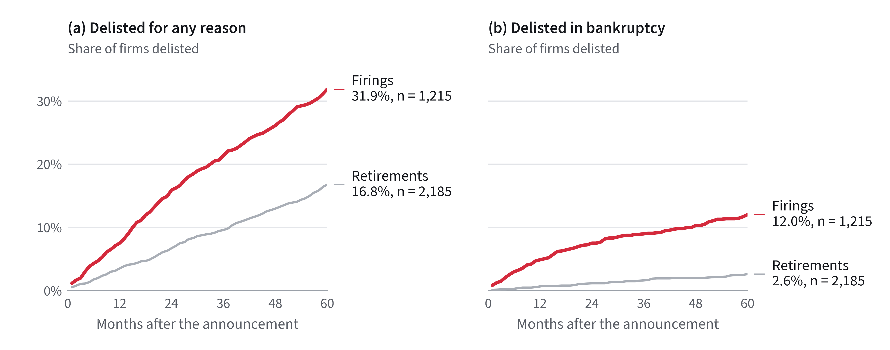
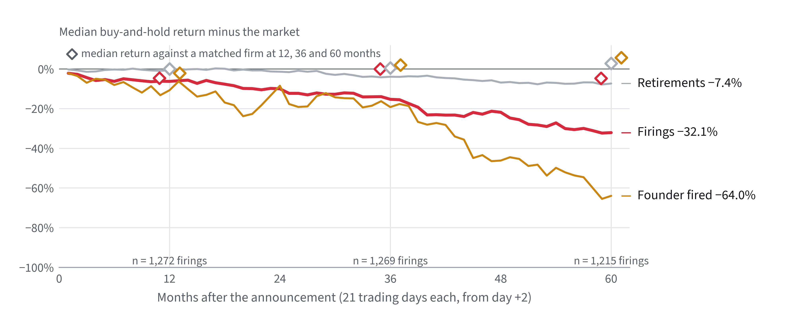
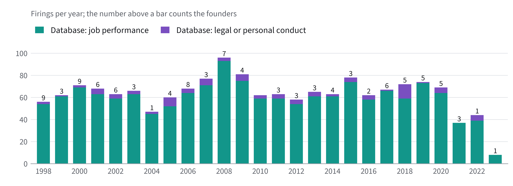

# Sacked: Sex, Fraud, Founders, and the Fate of Firms That Fire Their CEO

## Abstract

This paper answers what happens when the board of a Standard & Poor's 1500 firm fires its CEO. Over the six weeks before the announcement the shares lag the market by 5.4%, and over the three trading days around it they fall a further 2.3%. After a sex or other personal scandal the fall is not significantly different from other firings (p = 0.317) and 5.4 percentage points smaller than after fraud. After a founder's firing it is not significantly larger (p = 0.627). Within five years 12.0% of firing firms go bankrupt, against 2.6% after a retirement.

::: keynumbers

- **[−2.3%]{.focal}** fall in the share price, net of the market, over the three trading days around the announcement of a firing (n = 528)

- **12.0%** of firing firms bankrupt within five years (n = 1,215), against 2.6% after a retirement; a further 19.0% are taken over

:::

## 1. Introduction

::: findings

1. In the six weeks before a firing is announced, the shares lag the market by 5.4% (Table 1).

2. Over the three trading days around the announcement they fall a further 2.3%, and the next three months add no significant move (Table 1).

3. After a firing over a personal scandal the shares fall 1.5%, against 2.3% after other firings and 6.9% after fraud or other legal violation (Table 2).

4. A founder's firing is followed by a fall of 3.2%, against 2.2% for a hired CEO, a gap the test cannot tell from zero (Table 2).

5. Within five years 12.0% of firing firms go bankrupt and 19.0% are taken over, against 2.6% and 14.1% after a retirement (Table 4).

:::

In 1985 Apple's board backed its chief executive officer (CEO), John Sculley, against Steve Jobs, and Jobs left the company he had co-founded. By 1997 Apple had bought his next company and he was back in charge. In November 2026, after our sample ends, Nvidia's board accepted the resignation of its co-founder and CEO, Jensen Huang [@nvidia2026form8k]. Three days earlier it had opened an independent investigation after reports that Huang had been the target of a foreign intelligence effort [@nvidia2026board]. News reports also described an affair [@cnbc2026nvidia].

The board gave no reason, but a resignation during a board investigation is what this paper counts as a firing. Nvidia's shares closed 4.3% lower on 12 November, the first trading day after the news, having fallen as much as 14% during the session [@cnbc2026nvidia]. By our calculation from Sharadar's adjusted daily closes, they had lost 19.1% from 6 November, the last close before the board's statement, to 18 November.

The question for investors, directors and employees is what happens to a company after its board fires the CEO. Does it matter that the person fired built the company, or that the trouble was a personal scandal rather than fraud? This paper answers both questions for the CEOs fired by the boards of Standard & Poor's (S&P) 1500 firms from 1998 to 2023. There are 1,272 such firings with share prices, 83 of them founders. The 121 firings over fraud or other legal violation are kept apart as a comparison, because there the firm itself is in trouble with the law.

In the six weeks before a firing is announced, the shares lag the market by 5.4%, consistent with boards firing CEOs after poor results [@jenter2015]. The announcement still moves them: they fall a further 2.3% over three trading days (Table 1). Against a similar firm they trail by 4.6% over the first year (p = 0.035), and not significantly at three and five years.

After a firing over fraud or other legal violation the shares fall 6.9%, against 2.3% after other firings (Table 2). A personal scandal is followed by a fall of 1.5%, not significantly different from other firings: the 95% interval for the gap runs from -0.8 to 2.6 percentage points.

A founder's firing is followed by a fall of 3.2%, against 2.2% for a hired CEO (Table 2). The gap is not significant (p = 0.627), and its 95% interval runs from -5.1 to 3.1 percentage points.

Within five years 12.0% of firing firms go bankrupt, against 2.6% after a retirement, and 19.0% are taken over, against 14.1% (Table 4).

A portfolio of firing firms, held for three years after each announcement, earns 0.03% a month after adjusting for risk. Its 95% interval, from -0.35% to 0.42%, is too wide to rule out gains or losses of several percent over three years.

::: glance

### Table 1. The firing, horizon by horizon: S&P 1500 firms, 1998 to 2023

| Horizon | What is measured | Firings | Retirements | N firings | p |
|---|---|---|---|---|---|
| Panel A. Returns |  |  |  |  |  |
| Trading days −30 to −2 | Return minus the market | -5.4% | 0.0% | 531 | <0.001 |
| Trading days −1 to +1 | Abnormal return, market model | -2.3% | -0.3% | 528 | <0.001 |
| Trading days +2 to +60 | Return minus the market | -1.0% | -0.8% | 521 | 0.465 |
| 12 months | Return minus a matched firm, median | -4.6% | 0.0% | 1,220 | 0.035 |
| 36 months | Return minus a matched firm, median | 0.0% | 0.5% | 1,217 | 0.735 |
| 60 months | Return minus a matched firm, median | -4.7% | 2.8% | 1,164 | 0.246 |
| Months 1 to 36 | Risk-adjusted return (alpha), per month | 0.03% | 0.13% | 319 | 0.863 |
| Panel B. The firm |  |  |  |  |  |
| Within 60 months | Share of firms delisted * | 31.9% | 16.8% | 1,215 | <0.001 |
| Fiscal year +1 | Change in return on assets minus the matched firm, median, percentage points | -0.4 | 0.2 | 971 | 0.057 |
| About two years | Share of earlier directors not in the later proxy statement * | 48.0% | 37.8% | 566 | <0.001 |

*Notes.* Firings exclude those over fraud or other legal violation. Day 0 is the first trading day on or after the announcement. The first three rows use well-dated firings (dated by the database or by hand), the rest every firing. A month is 21 trading days from day +2. The alpha is the monthly intercept from the five Fama-French factors and momentum; its N counts calendar months. N falls with the horizon as recent firings have not reached it. p tests the firing number against zero, or, in rows marked *, against retirements.

:::

## 2. Related work

Boards fire CEOs after poor performance, including poor performance of the whole industry [@jenter2015], and returns fall well before the change [@weisbach1988]. Firing after an industry downturn can be an efficient rematch of CEOs and firms rather than a mistake [@eisfeldt2013]. Firings are rare, which suggests that boards behave as if replacing a CEO were costly [@taylor2010; @kaplan2012], and large pay cuts serve as a substitute [@gao2012]. Accounting performance deteriorates before a CEO change and improves after it [@huson2004], and volatility rises more after forced than after voluntary exits [@clayton2005]. How the market reacts depends on what the firing reveals about the firm [@kind2011; @chen2026]. A firing should therefore lower the share price at the announcement, but by less than the decline that preceded it.

Founder-led firms invest differently and have been valued more highly [@fahlenbrach2009]. Founder status itself responds to performance [@adams2009], founders are often replaced as their firms mature [@wasserman2003; @aran2024], and in venture-backed startups replacing the founder improves outcomes [@ewens2018]. The value of a founder's leadership may decline with time since the listing [@bebchuk2017], and insiders' voting control beyond their cash-flow rights goes with lower firm value [@gompers2010]. Yet CEO turnover at dual-class firms is as sensitive to performance as elsewhere [@aran2025]. When a CEO dies suddenly, the average share price reaction does not differ between founders and other CEOs [@jenter2023]. In Poland, poorly performing founder-CEOs are less likely to be fired than outside CEOs [@kowalewski2019]. If founders carry value a successor cannot replace, their firing should cost more. If boards act against founders only when the case is overwhelming, the firing could end entrenchment and be good news [@taylor2010].

Executive scandals and financial misreporting both cost shareholders [@cline2018; @larcker2016; @borellikjaer2021; @karpoff2008jfqa], and managers who misreport usually lose their jobs [@karpoff2008jfe]. Boards fire CEOs who manage earnings before outside penalties arrive [@hazarika2012], and more often where employees and directors are prosocial [@bereskin2020]. Shares also fall when a CEO is accused of sexual misconduct [@mooibroek2021] and when a firm reports sexual harassment [@abeysekera2024]. Board resignations rose at exposed firms after the #MeToo revelations of 2017 [@baharad2026]. @cline2018 separate personal indiscretions from misconduct in the business and measure the return when the indiscretion becomes public. We measure the firing that follows, and compare it with firings over fraud. A fraud tells investors that numbers they relied on were wrong, while a personal scandal concerns one person, so a firing over a personal scandal should cost less.

Relative to these studies, the paper compares in one sample three things usually studied apart: who was fired, why the board acted, and what became of the firm. It follows each firing from six weeks before the announcement to five years after, with the number of firms measured at every horizon. It checks by hand who was a founder, why the board acted and, for founders and personal scandals, when the firing was announced.

## 3. Data and design

### Which firings

The departures come from the open CEO dismissal database of @gentry2021, which its authors have extended to cover 1992 to 2023. It codes the reason for every CEO departure at S&P 1500 firms from press coverage and filings, and an independent recoding agreed with it on 87% of events [@gentry2021]. Codes 3 and 4, dismissal for job performance and for legal violations or personal conduct, are firings. Code 5, voluntary retirement, is the comparison group.

Press releases rarely say that a CEO was fired [@gow2017], and how firings are classified changes the results [@fee2018]. Like the database, we treat a resignation under board pressure as a firing, including one during an investigation, a scandal or an activist campaign.

From the firings we remove the 121 whose main reason is fraud or other legal violation. These cover financial misconduct, a legal or regulatory breach by the firm and criminal charges against the CEO. A personal scandal is a firing over sexual misconduct, a relationship with an employee, conduct at work or another personal failing such as a false degree. There are 40 of them, of which 3 are founders, too few for a test.

Each departure is linked to the firm's Central Index Key, its identifier at the Securities and Exchange Commission, and through it to daily prices that include firms later delisted. Prices and fundamentals come from Sharadar's Core US Equities data. Table IA.1 traces the firings from the database to the samples, and Figure IA.1 shows them by year.

### Dating the announcement

A three-day window needs the right day. The database gives an announcement date for about a third of departures, and otherwise only the day the CEO left office, which can come weeks after the news. The firm's 8-K, the filing a company must make within four business days of a CEO change, gives a second date. On departures the database does date, the two agree within 3 days in only 58% of cases.

Firings dated by the database fall 2.4% over three days and firings dated only from a filing 0.6% (Table IA.4). A misplaced day 0 would produce this gap, but so could differences between the firings the database chooses to date. Announcement results therefore use the 531 well-dated firings, dated by the database or by hand. Results over months and years use all 1,272, since an error of a few days is small against a window of 252 trading days or more.

The founder and personal-scandal tests rest on few well-dated firings, so we dated the rest of them by hand. For each, we read the firm's 8-K, its press releases and New York Times reports, and kept a date only when a dated source states it. The well-dated founder firings rise to 52 and the personal-scandal firings to 39; firings with no dated source stay out of the announcement tests.

### Founders and reasons

For each departure a language model (DeepSeek, deepseek-chat, at temperature zero) codes whether the CEO founded the firm or its predecessor. It also codes whether the exit was forced and the board's main reason, each with a supporting quote. It reads the database's notes and sources, the 8-K, cited press releases, the CEO's Wikipedia article and matching New York Times articles. We call this the evidence-based coding.

Every founder code on a firing was then checked by hand, as was every financial-misconduct, sexual-misconduct, relationship and other personal-conduct code. The checks were made by one coder; a second coder's check of a random fifth of the codes is planned. The model coded 191 firings as founder removals; the review confirmed 148, rejected 43 and added 2. About half of the model's other personal-conduct codes turned out to be pay disputes, unexplained personal reasons or criminal charges.

The model's reading of whether an exit was forced is cautious. Of the 531 well-dated firings it reads 192 as forced, 46 as not forced and 293 as unclear, mostly because the sources do not say. On the 190 where it agrees, the fall is 1.6% (Table IA.4), against 2.3% on all well-dated firings. The headline fall may therefore include some firings that were not described as forced at the time.

### Returns

The announcement return is the abnormal return over the three trading days from the day before the announcement to the day after it, from the market model of equation (1). The market model predicts the stock's return from the market's, using the stock's own past relation to the market.

$$AR_{it} = R_{it} - \hat\alpha_i - \hat\beta_i R_{mt}, \qquad CAR_i = AR_{i,-1} + AR_{i,0} + AR_{i,+1}. \tag{1}$$

Here $R_{it}$ is the stock's total return and $R_{mt}$ the market's. The coefficients come from trading days -250 to -30 before the announcement. We test the mean with the cross-sectional t and the standardized test of @boehmer1991, and the median with the Wilcoxon signed-rank test [@kothari2007]. Over the six weeks before and three months after, we use returns minus the market instead. A firm that was falling before the event has a negative alpha; carried forward, it would make ordinary returns afterwards look like a recovery.

For the long run, the main measure is the buy-and-hold return from day +2 over 252, 756 or 1260 trading days. Equation (2) subtracts the market's or a matched firm's return:

$$BHAR_i(h) = \prod_{t=2}^{T_h}(1+R_{it}) - \prod_{t=2}^{T_h}(1+R_{bt}). \tag{2}$$

The matched firm is in the same Fama-French industry, within 30 percent in market value, with the nearest return on assets. It had no recorded CEO change in the three years before. Matching on prior profitability follows @barber1996, whose tests are well specified only when firms are matched on performance before the event. We also form a calendar-time portfolio of every firm in its first 36 months after an announcement. Its excess return is regressed on the five Fama-French factors and momentum [@famafrench2015; @lyon1999], and the intercept, the alpha, is the monthly return left over.

On the day a firm is delisted, its return is set to zero for a takeover, minus 100% for a bankruptcy and minus 30% otherwise [@shumway1997]. Firms that fire their CEO are about half the size of those whose CEO retires. Their median market value at the fiscal year-end before is 1.0 billion dollars, against 1.9 (Table IA.2). Every long-run comparison is therefore also made against a matched firm or within size bands.

## 4. The stock around the announcement

Figure 1 shows the returns of firing and retirement firms from six weeks before the announcement to three months after it. For retirement firms the line stays within one percentage point of zero. For firing firms it slides for six weeks, drops at the announcement and then moves sideways.

*Figure 1. Prices slide before the firing, drop on the news, then stop.* Notes. Cumulative return minus the market from trading day -30 to day +60 around the announcement (day 0), well-dated firings with every day of the window. Panel (a) shows means, with the 95% confidence band for firings; the grey band marks days -1 to +1. Panel (b) shows medians, so that one firm cannot move a small group's line. The lines sum daily returns, so their end points differ slightly from the window returns of Table 1.

In the six weeks before the announcement, the shares of firing firms lag the market by 5.4%, while those of retirement firms do not move (0.0%). Over the three days around the announcement they fall a further 2.3% (t = -5.18), against -0.3% for retirements (Table 2).

Other measures give a similar fall: the five-factor model gives -2.2% over the same three days. The standardized test, which weights each firm by the precision of its estimate, gives t = -5.21 (Table 2). Over the next three months the shares earn -1.0% against the market, which is not statistically significant (p = 0.465, n = 521).

### Table 2. The announcement: abnormal returns over trading days −1 to +1

| Group | Mean | Median | t | p | N |
|---|---|---|---|---|---|
| Panel A. By group |  |  |  |  |  |
| CEOs fired | -2.3% | -1.2% | -5.18 | <0.001 | 528 |
| CEOs who retired | -0.3% | -0.3% | -1.45 | 0.147 | 969 |
| Founder fired | -3.2% | -0.4% | -1.56 | 0.126 | 52 |
| Hired CEO fired | -2.2% | -1.3% | -5.02 | <0.001 | 476 |
| Fired over a personal scandal | -1.5% | -1.6% | -1.99 | 0.054 | 39 |
| Fired for another reason | -2.3% | -1.2% | -4.97 | <0.001 | 489 |
| CEOs fired, five-factor model | -2.2% |  | -4.98 | <0.001 | 528 |
| Sex or relationship scandal | 0.3% | 0.7% | 0.24 | 0.810 | 16 |
| Fired for fraud or other legal violation (comparison) | -6.9% | -3.9% | -3.28 | 0.002 | 41 |
| Panel B. Differences, percentage points |  |  |  |  |  |
| Founder minus hired CEO | -1.0 |  | -0.49 | 0.627 | 528 |
| Personal scandal minus other firings | 0.9 |  | 1.01 | 0.317 | 528 |
| Personal scandal minus fraud or other legal violation | 5.4 |  | 2.44 | 0.018 | 80 |

*Notes.* Market-model abnormal return from trading day -1 to +1 around the announcement (day 0), the model estimated over days -250 to -30. The t statistic is the cross-sectional t of the mean (Panel B: the Welch t of the difference); p is two-sided.Every row uses well-dated firings: dated by the database or by hand. Firings exclude those for fraud or other legal violation, a comparison only. A personal scandal is sex, a relationship or other personal conduct; founder, scandal and fraud labels are hand-checked. The sex or relationship row (n = 16) is too small for a test. The Boehmer, Musumeci and Poulsen test gives t = -5.21 for CEOs fired.

### Personal scandals and fraud

After a firing over a personal scandal the shares fall 1.5% over the three days, against 2.3% after other firings and 6.9% after fraud or other legal violation (Table 2).

The personal-scandal gap of 0.9 percentage points is not statistically significant (p = 0.317, n = 528). Its 95% interval runs from -0.8 to 2.6 percentage points, so a scandal firing may cost somewhat more than other firings or somewhat less.

Fraud is followed by a fall 5.4 percentage points larger than after a personal scandal (p = 0.018, n = 80). For fraud, though, the firing is often announced with the fraud itself, so this fall includes the news of the fraud as well as of the firing.

With size, the prior year's return and the year held constant, the personal-scandal gap is 0.2 percentage points (p = 0.889, n = 513; Table IA.4). Table IA.6 and Figure IA.2 break the other firings down by the reason coded for them. The firing may say little about the business, or the market may have priced the scandal when it first broke. To separate the two, we went back to the first press report.

We searched the New York Times Archive for personal misconduct by sitting CEOs of the sample's firms and checked each report by hand (Table IA.7). The search finds 27 scandals. In 19 the CEO left within a year; in 8 the board kept them, among them Jeff Bezos at Amazon and Bobby Kotick at Activision Blizzard. It finds only 12 of the database's firings over a personal scandal, mostly at the largest firms, so these cases describe prominent scandals and support no test.

For the 24 scandals with share prices at the time, the shares fell 2.2% against the market over the three trading days around the first report. They fell 2.4% where the CEO later left (16 cases) and 1.9% where the board kept them (8), too few cases to tell apart.

### Founders

A founder's firing is followed by a fall of 3.2% over the three days, against 2.2% for a hired CEO (Table 2). The gap of -1.0 percentage points is not statistically significant (p = 0.627).

With 52 well-dated founder firings, the test can detect a gap of about 5.9 percentage points (Table IA.3). The 95% interval for the gap runs from -5.1 to 3.1 percentage points.

With firm size, the prior year's return and the year held constant, fired founders fall 0.8 percentage points less than hired CEOs (p = 0.647; Table IA.4). Founder firms slide further before the announcement: 8.8% over the six weeks, against 5.4% for all firings, on returns minus the market (Table IA.5).

The 95% interval for the return after a founder's firing reaches up to 0.8%, so a gain at the announcement is unlikely, though the estimate is imprecise. Nvidia's 4.3% fall on 12 November is a little larger than the average after a founder's firing.

Three founders were fired over a personal scandal: John Schnatter at Papa John's, Steve Wynn at Wynn Resorts and Vince McMahon at World Wrestling Entertainment (WWE). WWE's shares rose 7.9% over the three days around McMahon's departure (Table IA.8); three cases do not support a test.

## 5. Which firms are delisted

Within five years of a firing, 31.9% of the 1,215 firms with a complete horizon have been delisted: 19.0% in a takeover and 12.0% in bankruptcy (Table 4).

After a retirement, 16.8% of 2,185 firms are delisted, 14.1% in a takeover and 2.6% in bankruptcy (Figure 2). Most of the gap is therefore bankruptcy. Takeovers are the larger share in both groups, which fits the view that board removal and takeover are two routes to a change of control [@morck1989].

*Figure 2. Within five years, 31.9% of firing firms are delisted.* Notes. Cumulative share of firms delisted, by month after the announcement, for firms with a complete 60-month horizon: (a) for any reason, (b) in bankruptcy. Most of the rest are takeovers; Table 4 gives the shares.

Firing firms are about half as large as retirement firms, and small firms fail more often, so Table 3 compares firms of similar size. In the smallest band, under $300 million, 24.2% of firing firms go bankrupt within five years, against 13.5% of retirement firms. Above $5 billion the bankrupt shares are 0.8% and 0.0%.

Firing firms are delisted more often in every band: from $1 to 5 billion, 26.6% within five years, against 15.6% of retirement firms (p < 0.001; Table 3).

### Table 3. Firms delisted within 60 months, by market value before the firing

| Market value | Delisted, firings | Delisted, retirements | p | Bankrupt, firings | Bankrupt, retirements | N firings | N retirements |
|---|---|---|---|---|---|---|---|
| Under $0.3 billion | 45.0% | 32.3% | 0.004 | 24.2% | 13.5% | 318 | 229 |
| $0.3 to 1 billion | 33.9% | 20.4% | <0.001 | 8.9% | 3.1% | 280 | 515 |
| $1 to 5 billion | 26.6% | 15.6% | <0.001 | 7.8% | 1.1% | 335 | 793 |
| Over $5 billion | 14.8% | 9.2% | 0.023 | 0.8% | 0.0% | 250 | 617 |
| All, bankruptcies within 180 days of the announcement set aside | 29.8% | 16.6% |  | 9.3% | 2.4% | 1,179 | 2,180 |

*Notes.* Market value at the fiscal year-end before the departure, in US dollars. Delisted: the stock left the price file (taken over, bankrupt or other) within 60 months of the announcement. Bankrupt: the corporate action within 60 days of the final price was a bankruptcy or liquidation. p is a chi-square test of the share gone, firings against retirements. The last row sets aside firms whose bankruptcy was recorded within 180 days after the announcement, which were already failing when the CEO left. Only events with a complete 60-month horizon enter.

Some firms were already failing when the CEO left: for 36 of them a bankruptcy was recorded within 180 days of the announcement, as at Sears and Dana. Setting those aside, 29.8% of firing firms are delisted within five years and 9.3% go bankrupt.

With controls for size, return on assets, year and industry, firing firms are 9.0 percentage points more likely to be delisted within five years (Table 4). Adding the prior year's return, leverage, book-to-market, a distress score and a loss flag lowers the gap to 6.6 percentage points (p = 0.005). Of that gap, 2.3 percentage points is bankruptcy. Leverage is the strongest predictor among these controls (Table IA.9).

Against their matched firms the difference is 6.9 percentage points (p < 0.001; Table IA.9). The firing need not cause the delisting: a board may fire the CEO of a firm it already expects to struggle.

Founder firms are delisted within five years in 37.2% of cases (Table 4). The gap from hired CEOs is not significant (p = 0.358), and its 95% interval runs from -6.5 to 17.8 percentage points.

After a personal scandal the share is 20.0% (n = 35). The gap from other firings is not significant (p = 0.179), and its 95% interval, from -30.0 to 5.6 percentage points, is too wide to say much either way.

### Table 4. Firms delisted within 12, 36 and 60 months, by group

| Group | Delisted, 12m | Delisted, 36m | Delisted, 60m | Acquired, 60m | Bankrupt, 60m | p vs retired | N, 60m |
|---|---|---|---|---|---|---|---|
| Panel A. Share of firms |  |  |  |  |  |  |  |
| CEOs fired | 7.6% | 21.3% | 31.9% | 19.0% | 12.0% | <0.001 | 1,215 |
| CEOs who retired | 3.5% | 9.5% | 16.8% | 14.1% | 2.6% |  | 2,185 |
| Founder fired | 10.8% | 30.5% | 37.2% | 19.2% | 15.4% | <0.001 | 78 |
| Hired CEO fired | 7.4% | 20.6% | 31.5% | 19.0% | 11.8% | <0.001 | 1,137 |
| Fired over a personal scandal | 5.0% | 20.0% | 20.0% | 17.1% | 2.9% | 0.778 | 35 |
| Fired for another reason | 7.7% | 21.3% | 32.2% | 19.1% | 12.3% | <0.001 | 1,180 |
| Fired for fraud or other legal violation (comparison) | 9.1% | 19.8% | 34.2% | 23.3% | 10.0% | <0.001 | 120 |
| Panel B. Differences in the 60-month share, percentage points |  |  |  |  |  |  |  |
| Firings minus retirements |  |  | 15.1 |  |  | <0.001 | 3,400 |
| Firings minus retirements, controls for size, return on assets, year, industry |  |  | 9.0 | 3.7 | 4.9 | <0.001 | 3,337 |
| Firings minus retirements, adding prior return, leverage, book-to-market, distress, loss |  |  | 6.6 | 3.9 | 2.3 | 0.005 | 3,138 |
| Founder minus hired CEO |  |  | 5.7 |  |  | 0.358 | 1,215 |
| Personal scandal minus other firings |  |  | -12.2 |  |  | 0.179 | 1,215 |

*Notes.* Share of firms whose stock left the price file within 12, 36 and 60 months of the announcement, among events with that horizon complete; N, 60m counts those for 60 months. Acquired and Bankrupt classify the corporate action within 60 days of the final price. p vs retired: chi-square test of the 60-month share against retirements. Small groups can show a lower share at 60 months than at 36, as fewer firms reach 60 months. Panel B: the 60-month gap, raw and as the firing coefficient in a linear probability model with the controls named and year and industry effects, standard errors clustered by year. Its N counts firings and retirements.

## 6. Returns, profits and the board over five years

Do the higher bankruptcy rates leave shareholders with lower risk-adjusted returns? A portfolio of every firm in its first 36 months after a firing earns an alpha of 0.03% a month (Table IA.10). The 95% interval runs from -0.35% to 0.42% a month, wide enough to include gains or losses of several percent over three years.

Against a portfolio of retirement firms the difference is -0.12% a month (p = 0.516). The portfolio of personal-scandal firms earns 1.49% a month (t = 4.68), but it holds about a dozen firms over 35 months, so one or two firms can drive it. We do not read it as evidence that scandal firms outperform.

Against the market alone, the median firing firm's buy-and-hold return trails by 32.1%, and the median retirement firm's by 7.4%, after five years (Figure 3). Fired founders trail it by 64.0%, but they are small and were falling; against a matched firm their median is 5.7% (n = 70; Table IA.11).

*Figure 3. Against the market the long run looks grim; against a matched firm it does not.* Notes. Median buy-and-hold return minus the market, month 1 to month 60 after the announcement, in months of 21 trading days from day +2, all firings. Diamonds mark the median return against a matched firm at 12, 36 and 60 months; Table IA.11 gives the numbers.

A typical stock lags an index over long horizons, because a few large winners lift the index average. A matched firm of the same industry, size and profitability removes that effect. Against it, the median firing firm's buy-and-hold return is -4.6% after one year (p = 0.035), and 0.0% and -4.7% after three and five years, neither significant (Table IA.11). The means are 2.3% and 11.7%, also not significant. A few large winners pull the mean above the median, which is why the median and the alpha are the measures we read.

Profits fall in the year of the firing and then recover. In the fiscal year of the departure, return on assets falls 2.0 percentage points against the matched firm (p < 0.001; Table IA.12 and Figure IA.3). By fiscal year +2 the gap is 0.3, on the firms still filing.

About two years after a firing, 48.0% of the directors in the last proxy statement before it are missing from the later one, against 37.8% after a retirement (Table IA.13). The proxy statement is the annual filing that lists the directors standing for election. A proxy does not say why a director left, so these shares do not separate resignations, directors not nominated again and lost votes. Directors are matched on surname and first initial, which may overstate both shares.

A fired founder sits on the board two years later at 9.7% of firms, against 3.6% for a fired hired CEO and 33.3% for a retired one (Table IA.13). These results cover the 1,876 departures whose firms filed a proxy statement both before and about two years after.

## 7. Firings over fraud and legal violations

Treating personal scandals and fraud as one group of misconduct would blur two different outcomes. Within five years 34.2% of the firms that fired their CEO over fraud or other legal violation are delisted, 17.4 percentage points more than after a retirement (p < 0.001). After a personal scandal the share is 20.0%, not significantly different from retirements (p = 0.778; Table 4). Pooling the two would also hide the gap of 5.4 percentage points at the announcement.

## 8. Conclusion

When a board fires its CEO, the shares have usually been falling for weeks, and the announcement still takes them down a further 2.3% over three days. Against similar firms they trail by 4.6% in the first year, and not significantly at three or five years (Table 1).

Fraud is followed by a larger fall, 6.9%. A personal scandal is followed by a fall of 1.5%, not significantly different from other firings (p = 0.317). A founder's firing is followed by a fall of 3.2%, not significantly larger than a hired CEO's (p = 0.627; Table 2). The estimate is imprecise: a gap of several points cannot be ruled out.

Within five years 12.0% of firing firms go bankrupt, against 2.6% after a retirement, a gap that shrinks but remains with controls for leverage and distress (Table 4). For investors and directors, the risk that sets firing firms apart is bankruptcy. After the first year, their shares do not significantly trail matched firms (Table 1). A portfolio of all firing firms, bankrupt ones included, earns an alpha of 0.03% a month.

The sample covers S&P 1500 firms, so it says little about smaller companies, where founders often hold more control. Only three founders were fired over a personal scandal, and too few scandals in which the board kept its CEO reached the press to test. Fewer than half the firings have a precise announcement date, and the evidence-based coding reads about a third of those as clearly forced. The fall after a fraud firing includes the news of the fraud. We do not control for who succeeds the CEO, although most new CEOs are insiders or people the board already knows [@cziraki2022]. The comparisons describe what follows a firing, not what would have happened had the board kept its CEO.

## Internet Appendix

### Sample and firms

Table IA.1 traces the firings from the CEO dismissal database to the samples, and Figure IA.1 counts them by year. In the fiscal year before the departure, firing firms are smaller and less profitable than retirement firms: their median return on assets is 7.8%, against 12.3% (Table IA.2).

### Table IA.1. From the database to the main sample

| Step | N |
|---|---|
| Firings in the database, departures 1998 to 2023 | 1,799 |
| with an SEC company identifier | 1,620 |
| with a price history covering the announcement | 1,441 |
| with announcement returns | 1,393 |
| less firings for fraud or other legal violation (comparison only) | 121 |
| firings for any other reason (the paper's sample) | 1,272 |
| well-dated: by the database or by hand (announcement sample) | 531 |
| Founder codes from the model, all firings | 191 |
| founders confirmed by hand | 150 |
| of which departures 1998 to 2023 | 132 |
| of which with returns, firings over fraud or other legal violation excluded | 83 |
| of which well-dated (announcement sample) | 52 |

*Notes.* Firings are database codes 3 and 4; firings over fraud or other legal violation leave the sample after the hand review of their codes. A price history covers the announcement when the security trades from 60 days before day 0. Founder codes come from the evidence-based model coding; every one on a firing was checked by hand, which also added founders the model had left unclear.

*Figure IA.1. Firings per year.* Notes. Every firing in the database by year, 1998 to 2023, by the database's dismissal type, whether or not the firm has share prices, less firings over fraud or other legal violation. The bars therefore total more than the paper's 1,272 firings with prices. The number above each bar counts the hand-confirmed founders among them; the founder count in Table IA.1 also includes founders fired over fraud. The last year covers part of 2023.

### Table IA.2. Who gets fired: the firm in the year before the departure

| Fiscal year -1, medians | Firings | Retirements | Founders fired | p, firings vs retirements | N firings |
|---|---|---|---|---|---|
| Market value, USD billion | 1.0 | 1.9 | 0.8 | <0.001 | 1,240 |
| Return on assets, year -1 (EBITDA / assets) | 7.8% | 12.3% | 7.6% | <0.001 | 1,240 |
| Sales growth | 2.9% | 6.7% | 8.5% | <0.001 | 1,215 |
| Capital spending / assets | 3.2% | 3.5% | 4.2% | <0.001 | 1,240 |

*Notes.* Medians in the fiscal year before the departure, from as-reported annual statements; market value at that fiscal year-end. Return on assets is earnings before interest, taxes, depreciation and amortization (EBITDA) over total assets. p is from a Mann-Whitney U test of firings against retirements. N firings is the number of firings with the item.

### The announcement

The founder gap is negative in all three windows of Table IA.3 and significant in none. With 52 founders, the smallest gap the main test could detect is 5.9 percentage points.

### Table IA.3. The founder gap in every window

| Window (trading days) | Founder fired | Hired CEO fired | Gap, pp | p | Detectable gap, pp | N founders |
|---|---|---|---|---|---|---|
| Days 0 to +1 | -4.0% | -2.0% | -2.0 | 0.373 | 6.2 | 52 |
| Days -1 to +1 | -3.2% | -2.2% | -1.0 | 0.627 | 5.9 | 52 |
| Days -5 to +5 | -6.0% | -2.2% | -3.8 | 0.370 | 11.8 | 52 |

*Notes.* Mean market-model abnormal returns of fired founders and fired hired CEOs over each window, the gap with its Welch p, and the smallest gap the test would detect with 80% power at the 5% level. The paper's main window is days -1 to +1.

Table IA.4 changes one thing at a time against the main tables. With the five-factor model plus momentum, the founder gap is -1.0 percentage points and the personal-scandal gap 1.7 percentage points. Returns minus the market, with no estimated model, give -2.5% over the three days. Using every firing, whatever its date source, gives -1.3%.

On the 190 well-dated firings that the evidence-based coding also reads as forced, the return over trading days -1 to +1 is -1.6%. Excluding 2008 and 2009 gives -2.4%, and dropping firings coded as leaving for a new job gives -2.2%.

The long-run results do not depend on how delisting returns are set. With every delisting return at zero, the median three-year return against the market is -12.9%, and setting every delisting that is not a takeover to minus 100% gives -15.4%. When no firm meets the size band the nearest firm in size is the match (206 matches); using only matches within the band, the median three-year matched return is 0.0%.

For departures from 1992 to 1997, before daily prices for delisted firms exist, we use the five-year return graphs that firms print in their proxy statements. Of these departures, 225 have a usable graph, including 41 firings. The median three-year return against the firm's own reported index is -68.3% after firings and -39.5% after retirements. Only firms still filing three years later enter this check.

### Table IA.4. Robustness

| Specification | Estimate | p | N | Horizon |
|---|---|---|---|---|
| Panel A. The announcement return |  |  |  |  |
| Return minus the market instead of the market model | -2.5% | <0.001 | 528 | Trading days -1 to +1 |
| Evidence agrees the exit was forced | -1.6% | 0.032 | 190 | Trading days -1 to +1 |
| Adding retirements the evidence reads as pushed | -2.2% | <0.001 | 537 | Trading days -1 to +1 |
| Excluding 2008 and 2009 | -2.4% | <0.001 | 491 | Trading days -1 to +1 |
| Excluding firings coded as leaving for a new job | -2.2% | <0.001 | 505 | Trading days -1 to +1 |
| All dates, every firing with returns | -1.3% | 0.002 | 1,267 | Trading days -1 to +1 |
| Not precisely dated (8-K, news report or leaving office) | -0.5% | 0.385 | 739 | Trading days -1 to +1 |
| Dated by an 8-K only | -0.6% | 0.321 | 428 | Trading days -1 to +1 |
| Panel B. Gaps between groups at the announcement |  |  |  |  |
| Founder minus hired CEO, controlling for size, prior 12-month return and year | 0.8 pp | 0.647 | 513 | Trading days -1 to +1 |
| Personal scandal minus other firings, same controls | 0.2 pp | 0.889 | 513 | Trading days -1 to +1 |
| Five-factor plus momentum: founder minus hired CEO | -1.0 pp | 0.648 | 528 | Trading days -1 to +1 |
| Five-factor plus momentum: personal scandal minus other reasons | 1.7 pp | 0.057 | 528 | Trading days -1 to +1 |
| Evidence agrees: founder minus hired CEO | -0.2 pp | 0.973 | 190 | Trading days -1 to +1 |
| All dates: sex or relationship minus fraud | 6.5 pp | 0.010 | 71 | Trading days -1 to +1 |
| All dates: personal scandal minus other firings | -0.2 pp | 0.793 | 1,267 | Trading days -1 to +1 |
| All dates: founder minus hired CEO | -1.9 pp | 0.236 | 1,267 | Trading days -1 to +1 |
| Panel C. The long run |  |  |  |  |
| Return minus a matched firm, 36 months, matches within the size band only | 0.0% | 0.906 | 1,164 | 36 months (756 trading days) from day +2 |
| Evidence agrees: return minus the market, 36 months | -9.9% | 0.011 | 497 | 36 months (756 trading days) from day +2 |
| Return minus the market, 36 months, every delisting return 0 | -12.9% | <0.001 | 1,269 | 36 months (756 trading days) from day +2 |
| Return minus the market, 36 months, non-takeover delistings -100% | -15.4% | <0.001 | 1,269 | 36 months (756 trading days) from day +2 |
| Pre-1998: 3-year return minus reported index, firings minus retirements | -28.8 pp | 0.021 | 221 | Three fiscal years from the event year, departures announced 1992 to 1997 |

*Notes.* Each row changes one thing against the main tables. Evidence agrees: the CEO dismissal database codes the exit forced and the evidence-based coding (8-K, press releases, Wikipedia, New York Times) also reads it as forced. Pushed retirements: the database codes a retirement and the evidence reads it as forced. Pre-1998: departures announced 1992 to 1997, three-year return minus the index the firm itself reports in its proxy performance graph.

### Table IA.5. Before, at and after the announcement, by group

| Group | Days -30 to -2 | p | Days -1 to +1 | p | Days +2 to +60 | p | N |
|---|---|---|---|---|---|---|---|
| CEOs fired | -5.4% | <0.001 | -2.3% | <0.001 | -1.0% | 0.465 | 528 |
| CEOs who retired | 0.0% | 0.933 | -0.3% | 0.147 | -0.8% | 0.190 | 969 |
| Founder fired | -8.8% | 0.005 | -3.2% | 0.126 | 2.7% | 0.684 | 52 |
| Fired over a personal scandal | -4.3% | 0.030 | -1.5% | 0.054 | -3.5% | 0.411 | 39 |
| Fired for another reason | -5.5% | <0.001 | -2.3% | <0.001 | -0.8% | 0.581 | 489 |

*Notes.* Days -30 to -2 and +2 to +60 are cumulative market-adjusted returns (firm minus market), used because a firing firm's alpha before the event is strongly negative and a market model would project it forward. Days -1 to +1 is the market-model return of Table 2. Events need every day of a window. N is the number of departures in the days -1 to +1 window; the outer windows differ by at most a few percent.

Table IA.6 and Figure IA.2 split the firings by the reason coded for them. After a Holm correction for testing every reason, three falls remain statistically significant (Table IA.6). Where a push was described as a retirement or ill health the fall is 3.5% (Holm p = 0.003). Where the CEO was coded as leaving for a new job it is 4.6% (Holm p = 0.015). After other personal conduct it is 2.7% (Holm p = 0.039); performance and the other reasons do not survive the correction.

### Table IA.6. Why the board acted: abnormal returns over trading days −1 to +1 by coded reason

| Coded primary reason | Mean | t | p | Holm p | N |
|---|---|---|---|---|---|
| Merger or restructuring | -9.2% | -2.35 | 0.028 | 0.167 | 24 |
| Left for a new job | -4.6% | -3.52 | 0.002 | 0.015 | 23 |
| Strategy or power dispute | -3.6% | -2.11 | 0.045 | 0.179 | 27 |
| Pushed out, described as retirement or health | -3.5% | -3.81 | <0.001 | 0.003 | 66 |
| Other personal conduct | -2.7% | -3.07 | 0.006 | 0.039 | 23 |
| Reason unclear | -1.6% | -1.71 | 0.090 | 0.271 | 93 |
| Performance | -1.6% | -2.21 | 0.028 | 0.167 | 221 |
| Relationship with an employee | -0.5% | -0.44 | 0.668 | 1.000 | 11 |
| Activist or shareholder pressure | -0.3% | -0.28 | 0.780 | 1.000 | 34 |

*Notes.* Firings for any reason but fraud or other legal violation, by the primary reason coded from the database notes, the 8-K filed within 10 days, cited press releases, Wikipedia and matched New York Times articles. Reasons with fewer than 10 cases are not shown. Holm p adjusts each p for the number of reasons tested. Financial-misconduct, sexual-conduct and relationship labels are hand-checked; the others are model codes.

*Figure IA.2. The announcement return by the reason the board acted.* Notes. Mean abnormal return over trading days -1 to +1 by the coded reason, well-dated firings, with 95% intervals; reasons with at least 10 firings. Table IA.6 gives the numbers.

Table IA.7 lists each scandal the New York Times search found, grouped by whether the board kept its CEO, with the return around the first report. The boards that kept their CEO include News Corp, Goldman Sachs, Amazon and Activision Blizzard; those whose CEO left include Boeing, Hewlett-Packard, Intel and McDonald's. Sexual relationships and harassment allegations appear on both sides. Table IA.8 lists the largest founders fired, with the return at the announcement and what became of the firm.

### Table IA.7. Personal scandals of sitting CEOs in the New York Times, 1998 to 2023

| Company | CEO | First report | Scandal | Days -1 to +1 |
|---|---|---|---|---|
| Panel A. The board kept the CEO |  |  |  |  |
| News Corp | Rupert Murdoch | 1998-10-04 | Sexual relationship | -15.0% |
| Global Crossing | John J. Legere | 2002-04-08 | Harassment allegation | 2.5% |
| Bausch & Lomb | Ronald L. Zarrella | 2002-10-19 | Other personal conduct | -1.1% |
| Goldman Sachs Group | Henry M. Paulson Jr. | 2003-02-04 | Other personal conduct | 0.3% |
| News Corporation | Rupert Murdoch | 2012-11-19 | Other personal conduct | 1.1% |
| KB Home | Jeffrey Mezger | 2017-09-19 | Other personal conduct | -2.8% |
| Amazon | Jeff Bezos | 2019-02-07 | Sexual relationship | 0.8% |
| Activision Blizzard | Bobby Kotick | 2021-07-29 | Harassment allegation | -0.8% |
| Mean, 8 cases |  |  |  | -1.9% |
| Panel B. The CEO left within a year |  |  |  |  |
| Ashland Inc. | Paul W. Chellgren | 2002-08-04 | Sexual relationship | 3.6% |
| Boeing Co | Harry C. Stonecipher | 2005-03-08 | Sexual relationship | 0.1% |
| RadioShack | David J. Edmondson | 2006-02-16 | Other personal conduct | -13.1% |
| Bear Stearns | James Cayne | 2007-11-02 | Other personal conduct | 1.2% |
| Hewlett-Packard | Mark V. Hurd | 2010-08-06 | Harassment allegation | -8.9% |
| Best Buy | Brian J. Dunn | 2012-04-10 | Sexual relationship | -0.7% |
| Yahoo | Scott Thompson | 2012-05-03 | Other personal conduct | -0.4% |
| Wynn Resorts | Stephen Wynn | 2018-01-26 | Harassment allegation | -20.0% |
| Lululemon Athletica | Laurent Potdevin | 2018-02-06 | Other personal conduct | 5.7% |
| Intel | Brian Krzanich | 2018-06-21 | Sexual relationship | -0.4% |
| Barnes & Noble | Demos Parneros | 2018-07-03 | Other personal conduct | -5.6% |
| Texas Instruments | Brian Crutcher | 2018-07-18 | Other personal conduct | -0.4% |
| McDonald's | Steve Easterbrook | 2019-11-03 | Sexual relationship | -3.7% |
| L Brands | Leslie H. Wexner | 2020-01-29 | Other personal conduct | 14.3% |
| Tapestry | Jide Zeitlin | 2020-07-21 | Sexual relationship | -1.2% |
| World Wrestling Entertainment | Vince McMahon | 2022-06-17 | Sexual relationship | -8.8% |
| Mean, 16 cases |  |  |  | -2.4% |

*Notes.* Reports of personal misconduct by a sitting CEO of a sample firm, found by searching the New York Times Archive and checked by hand. Panel B: the CEO departed within 12 months of the first report (CEO dismissal database, or a reported departure the database misses). Days -1 to +1: market-adjusted return around the first report. The table lists the 24 of the 27 scandals found whose shares traded around the first report. The search finds only a few of the database's firings over a personal scandal, mostly at the largest firms, so the table describes prominent cases, not a sample.

### Table IA.8. The largest founders fired, among firings both codings read as forced

| Company | Founder | Year | Database reason | Value, USD bn | Days -1 to +1 | 36 months | After 60 months |
|---|---|---|---|---|---|---|---|
| Yahoo | Jerry Yang | 2008 | Performance | 37.9 | 9.7% | -23.1% | still listed |
| Wynn Resorts | Steve Wynn | 2018 | Legal or personal conduct | 17.3 | 9.6% | -94.6% | still listed |
| Chesapeake Energy | Aubrey McClendon | 2013 | Legal or personal conduct | 13.1 | 4.7% | -117.5% | still listed |
| WWE | Vince McMahon | 2022 | Legal or personal conduct | 3.6 | 7.9% | 37.7% | under 5 years of data |
| Career Education | John Larson | 2006 | Performance | 3.4 | 14.9% | 12.9% | still listed |
| Acadia Healthcare | Joey Jacobs | 2018 | Performance | 3.3 | -8.4% | 14.9% | still listed |
| Papa Johns International | John Schnatter | 2017 | Legal or personal conduct | 3.1 | -4.9% | 7.4% | still listed |
| ICN Pharmaceuticals | Milan Panic | 2002 | Performance | 2.7 | 0.2% | -47.7% | still listed |
| Jetblue Airways | David Gary Neeleman | 2007 | Performance | 2.4 | 2.7% | -30.5% | still listed |
| Calpine | Peter Cartwright | 2005 | Performance | 1.5 | -58.7% | -76.6% | bankrupt |
| Cara Therapeutics | Derek Chalmers | 2021 | Performance | 1.0 | 1.0% | -125.6% | under 5 years of data |
| Pss World Medical | Patrick Kelly | 2000 | Performance | 0.8 | -15.9% | 225.3% | still listed |

*Notes.* Founder-CEOs fired, among exits the evidence-based coding also reads as forced, ranked by market value at the fiscal year-end before the departure. Database reason is the CEO dismissal database's code (performance = 3, legal or personal conduct = 4). Days -1 to +1 is the market-model abnormal return; 36 months is the buy-and-hold return minus the market from day +2; it can fall below -100% when the stock lost most of its value while the market rose. After 60 months reports whether the stock still traded, and if not, how it left.

### Survival, returns, profits and the board

### Table IA.9. Delisting within 60 months, with controls and against matched firms

| Outcome | Firings | Retirements | Firing effect with controls, pp | p | N |
|---|---|---|---|---|---|
| Delisted | 31.9% | 16.8% | 9.0 | <0.001 | 3,337 |
| Acquired | 19.0% | 14.1% | 3.7 | 0.065 | 3,337 |
| Bankrupt | 12.0% | 2.6% | 4.9 | <0.001 | 3,337 |
| Delisted, against the matched firm | 30.8% | 23.9% (matched) | 6.9 | <0.001 | 1,164 |
| Delisted, adding prior return, leverage, book-to-market, distress and loss |  |  | 6.6 | 0.005 | 3,138 |
| Acquired, same controls |  |  | 3.9 | 0.074 | 3,138 |
| Bankrupt, same controls |  |  | 2.3 | 0.003 | 3,138 |
| Founder, within firings, same controls |  |  | 1.6 | 0.801 | 1,082 |
| Personal scandal, within firings, same controls |  |  | -1.8 | 0.806 | 1,082 |
| Leverage (debt over assets), coefficient in the same model |  |  | 21.6 | <0.001 | 3,138 |

*Notes.* Firing effect with controls: the coefficient on the firing dummy in a linear probability model with log market value, return on assets (ROA) in fiscal year -1, event-year and Fama-French industry effects, standard errors clustered by year. The matched row compares each firing firm with its own matched firm (paired t). The rows marked same controls add the prior 12-month return, leverage, book-to-market, an Altman Z distress flag and a loss flag, on the firms with every item; the founder and personal-scandal rows estimate that model within firings.

### Table IA.10. Calendar-time alpha after the announcement

| Portfolio | Equal-weighted, % a month | t | Value-weighted, % a month | t | N months | Firms a month |
|---|---|---|---|---|---|---|
| CEOs fired, 12 months | 0.04% | 0.17 | -0.20% | -0.78 | 294 | 49 |
| CEOs who retired, 12 months | 0.16% | 1.68 | -0.16% | -1.27 | 298 | 89 |
| Firings minus retirements, 12 months | -0.15% | -0.60 | -0.04% | -0.15 | 294 |  |
| CEOs fired, 36 months | 0.03% | 0.17 | -0.11% | -0.70 | 319 | 127 |
| CEOs who retired, 36 months | 0.13% | 1.59 | -0.10% | -0.92 | 322 | 239 |
| Founder fired, 36 months | 0.38% | 0.43 | -0.22% | -0.24 | 128 | 11 |
| Fired over a personal scandal, 36 months | 1.49% | 4.68 | 0.39% | 0.79 | 35 | 12 |
| Firings minus retirements, 36 months | -0.12% | -0.65 | -0.02% | -0.10 | 319 |  |

*Notes.* Each calendar month the portfolio holds every firm whose announcement fell 1 to H months before. Its return minus the risk-free rate is regressed on the Fama-French five factors and momentum; alpha is the intercept, with Newey-West t (6 lags). Value weights are market values at the fiscal year-end before the event. Months with fewer than 10 firms are dropped. The difference rows regress the firing portfolio's return minus the retirement portfolio's. Delisted firms take their delisting return in their last month.

### Table IA.11. Long-run returns at 12, 36 and 60 months

| Group | 12m | 36m | 60m | p, 12m | p, 36m | p, 60m | N, 36m |
|---|---|---|---|---|---|---|---|
| Panel A. Median return minus the market |  |  |  |  |  |  |  |
| CEOs fired | -6.3% | -15.3% | -32.1% | <0.001 | <0.001 | <0.001 | 1,269 |
| CEOs who retired | -0.7% | -4.0% | -7.4% | 0.669 | 0.218 | 0.083 | 2,253 |
| Founder fired | -10.8% | -19.2% | -64.0% | 0.173 | 0.124 | 0.010 | 82 |
| Hired CEO fired | -6.1% | -15.0% | -31.2% | 0.001 | <0.001 | <0.001 | 1,187 |
| Fired over a personal scandal | -5.9% | 9.2% | 3.1% | 0.826 | 0.685 | 0.610 | 40 |
| Fired for another reason | -6.3% | -15.7% | -33.2% | <0.001 | <0.001 | <0.001 | 1,229 |
| Panel B. Median return minus a matched firm |  |  |  |  |  |  |  |
| CEOs fired | -4.6% | 0.0% | -4.7% | 0.035 | 0.735 | 0.246 | 1,217 |
| CEOs who retired | 0.0% | 0.5% | 2.8% | 0.834 | 0.457 | 0.108 | 2,194 |
| Founder fired | -2.2% | 2.0% | 5.7% | 0.716 | 0.629 | 1.000 | 74 |
| Hired CEO fired | -4.8% | -1.0% | -5.2% | 0.038 | 0.637 | 0.242 | 1,143 |
| Fired over a personal scandal | -8.0% | 3.4% | -4.1% | 0.609 | 0.931 | 0.554 | 40 |
| Fired for another reason | -4.6% | 0.0% | -4.7% | 0.040 | 0.708 | 0.209 | 1,177 |
| CEOs fired, mean | -0.9% | 2.3% | 11.7% | 0.748 | 0.735 | 0.387 | 1,217 |

*Notes.* Medians of buy-and-hold returns from day +2 over 12, 36 and 60 months, all firings, with the Wilcoxon p. Panel A subtracts the market's buy-and-hold return; Panel B subtracts a matched firm in the same industry, with market value within 30 percent and the nearest return on assets. The last row gives means with t-test p; skewed returns can give means and medians of opposite sign. Delisted firms take their delisting return and then hold the market. N, 36m counts events at 36 months.

### Table IA.12. Profitability against the matched firm, fiscal years 0 to +3

| Group | Year 0 | Year +1 | Year +2 | Year +3 | N, year +1 | N, year +3 |
|---|---|---|---|---|---|---|
| CEOs fired | -2.0 (<0.001) | -0.4 (0.057) | 0.3 (0.519) | 0.3 (0.537) | 971 | 760 |
| CEOs who retired | -0.2 (0.189) | 0.2 (0.144) | 0.3 (0.549) | 0.2 (0.379) | 1,922 | 1,629 |
| Founder fired | -2.2 (0.057) | -2.0 (0.190) | 1.4 (0.722) | -0.5 (0.518) | 52 | 38 |
| Hired CEO fired | -2.0 (<0.001) | -0.4 (0.101) | 0.2 (0.560) | 0.3 (0.419) | 919 | 722 |
| Fired over a personal scandal | 0.0 (0.692) | 0.0 (0.846) | 0.8 (0.777) | 1.8 (0.048) | 33 | 25 |
| Fired for another reason | -2.1 (<0.001) | -0.4 (0.058) | 0.3 (0.546) | 0.2 (0.761) | 938 | 735 |

*Notes.* Median change in return on assets (ROA) from fiscal year -1 to year 0 (the year of the departure), +1, +2 and +3, minus the same change at the matched firm, in percentage points, with the Wilcoxon p in parentheses. ROA is earnings before interest, taxes, depreciation and amortization (EBITDA) over total assets, winsorized at the 1st and 99th percentiles. N falls with the horizon because firms stop filing after a sale or bankruptcy.

*Figure IA.3. Profits and the board after the firing.* Notes. (a) Median change in return on assets from fiscal year -1, minus the same change at the matched firm, in percentage points, fiscal years 0 to +3. (b) About two years after the departure, three shares: pre-departure directors not named in the later proxy, firms with a separate chair and CEO, and firms where the departing CEO is still a director. Firings are red and retirements grey; the diamond marks fired founders.

### Table IA.13. The board about two years after the departure

| Group | Earlier directors gone | N | Split before | Split after | N, split | Departing CEO still a director |
|---|---|---|---|---|---|---|
| CEOs fired | 48.0% | 566 | 56.3% | 66.1% | 177 | 3.9% |
| CEOs who retired | 37.8% | 1,310 | 27.2% | 65.9% | 440 | 33.3% |
| Founder fired | 52.5% | 31 | 26.7% | 81.8% | 11 | 9.7% |
| Hired CEO fired | 47.8% | 535 | 58.5% | 65.1% | 166 | 3.6% |
| Fired over a personal scandal | 46.0% | 13 | 0.0% | 100.0% | 1 | 0.0% |

*Notes.* Director lists from the last proxy before the departure and the first one at least 600 days after it, matched on surname and first initial. Earlier directors gone: the share of earlier directors no longer on the board; a proxy does not say whether they resigned, were not nominated again or lost a vote. Split before and after: the chair and CEO roles held by different people in the earlier and the later proxy, on the departures where the later proxy names a chair (N, split; the earlier proxy names one slightly more often). For fired founders the last column is the founder; otherwise the departing CEO.

## References
